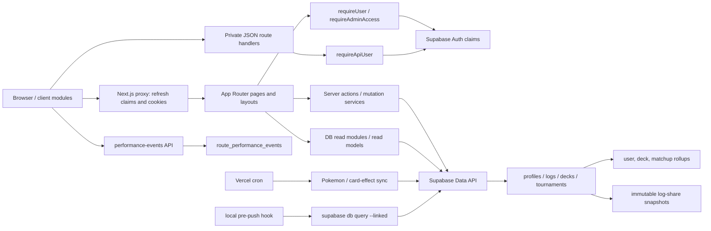

# PokeNotesV2 Application Health Review

- Date: 11 July 2026
- Review status: Complete; safe repairs and final validation verified
- Production investigation policy: Read-only
- Production changes made: None

## Executive summary

PokeNotesV2 has a sound application-code baseline and a coherent product surface, but its current production security posture is **at risk**. The deciding factor is not code style or build quality: three critical, live configuration findings can bypass the intended authorization model.

- An unauthenticated Supabase Data API client can enumerate `public.log_shares`, whose `payload` contains immutable battle-log and linked-deck snapshots.
- An authenticated user can update their own `profiles.role` value and promote themselves to the role trusted by application and database admin checks.
- The production test-login route is enabled and its URL bearer credential produces a session with administrative access.

These findings were confirmed without inspecting or displaying share payload contents, changing roles, changing production data, or exposing account details or secrets. No production schema, RLS policy, authentication setting, credential, deployment setting, or data was modified. Containment requires an explicitly owned security and operational response.

Outside those criticals, the application is materially healthier after this review. Safe repairs now provide typed `401` responses across private JSON APIs, prevent an infinite battle-log skeleton, tighten tournament round ownership checks, retain the newest bounded stats window, harden internal redirects, remove dependency advisories, enforce private local auth-file permissions, and address systemic accessibility/design issues in shared code. Focused tests cover those repairs.

Current performance is healthy in the measured production sample. On 11 July, `/logs` hard loads had 67 samples, p75 **426 ms**, p95 **652 ms**, and all sampled total-blocking-time values were **0 ms**. An older 30-day aggregate contains slower historical traffic, but it is not evidence of a current `/logs` regression.

### Overall health assessment

Scores use a 1–5 review scale, where 1 is unsafe/fragile and 5 is strong. They are a prioritization aid, not a production SLO.

| Discipline | Score | Assessment | Basis |
| --- | ---: | --- | --- |
| Security and authorization | 1/5 | Critical | Three confirmed production authorization/credential paths, plus excessive live grants and deployment-surface debt. |
| Architecture and maintainability | 3/5 | Mixed | Clear App Router/data-module boundaries and no import cycles; dual persistence and repeated mutation interfaces weaken locality. |
| Correctness and resilience | 3/5 | Mixed, improved | Strong baseline tests and read models; non-atomic multi-write operations and weak runtime JSON validation remain. |
| Performance | 4/5 | Healthy with database debt | Current-day RUM is healthy and route payloads are deliberately deferred; 64 live Supabase advisor notices need measured cleanup. |
| UI, accessibility, and responsiveness | 3.5/5 | Good, improved | Shared design system, responsive sampled routes, and systemic fixes landed; headings, picker groups, and target sizing remain. |
| Engineering and deployment readiness | 3/5 | Mixed | Lint/typecheck/test/build baseline is green; pre-push can mutate the linked database and CI omits some repository gates. |
| **Overall** | **2.5/5** | **At risk** | Critical live authorization findings outweigh an otherwise healthy application baseline. |

## Outcome summary

### Fixed now

The following changes are application-local, high-confidence, and do not alter intended product behavior, production data, authentication policy, schema, RLS, or deployment configuration.

1. **Medium — Private APIs now return typed, private/no-store `401` responses.** `lib/server/api-auth.ts`, `lib/server/api-response.ts:18-36`, and ten private route modules replace page-style redirect exceptions that were previously caught as generic `500` responses. `tests/api-auth.test.ts` covers the response and route contract.
2. **Medium — Deferred battle-log body failures now terminate in an explicit error/retry state.** `components/ui/BattleLogDetailShell.tsx:132-187` handles HTTP, network, and JSON failures; `components/ui/BattleLogDetailView.tsx:725-746` renders an accessible alert, retry action, and shared Skeleton state.
3. **High — Tournament round application mutations are better parent-scoped.** `app/(app)/tournaments/actions.ts:588-610` verifies tournament ownership before saving a round, and `:677-684` scopes deletion by round, tournament, and user. This is defense in depth; SEC-05 remains at the database boundary.
4. **Medium — The stats damage timeline retains and honestly labels the newest bounded window.** `lib/db/logs.ts:492-517` queries the newest 5,000 rows and reverses the selected window for chronological display. If a user exceeds the cap, the chart now says “Latest 5,000 games,” retains the all-time game numbers, and computes chart totals from that displayed window.
5. **Low — Internal redirect validation rejects backslashes and control characters.** `lib/server/action-redirect.ts:1-16` now rejects ambiguous path forms in addition to absolute and protocol-relative targets.
6. **High — Systemic contrast tokens and status text were repaired.** `app/globals.css:18-66,143-201` now gives muted/kicker and win/loss/warning text reviewed values; shared variants and direct text consumers use the strong semantic tokens. Page, card, and muted base-surface pairs measure at least 4.70:1. The design audit now rejects weak status/destructive text classes.
7. **High — Keyboard users can bypass repeated shell navigation.** `components/ui/AppShell.tsx:22-39` adds a visible-on-focus skip link to the shared `SidebarInset` main target.
8. **Medium — The `/decks` toolbar no longer relies on more than 320 px.** `components/ui/DeckStrategyCollection.tsx:131-151` stacks controls below 360 px and adds `min-w-0` containment.
9. **Medium — Reduced-motion and calculator states are accessible.** `app/globals.css:347-356` honors reduced-motion preference. The calculator now has a visible loading Skeleton/status, an initial screen-reader `h1`, alert semantics, and stable memo inputs (`components/calculator/LazyProbabilityCalculator.tsx:7-25`; `components/calculator/ProbabilityCalculator.tsx`).
10. **Medium — Seven inline strategy/matchup textareas now have programmatic labels.** `InlineDeckStrategyEditor` and `InlineDeckMatchupEditor` use `Field`, `FieldLabel`, `useId`, and matching `htmlFor`/`id`. Routine autosave states use polite status regions, failures use one assertive alert, and `AdminRoleControls` announces pending/error state with a per-instance accessible relationship. `tests/inline-editor-accessibility.test.ts` has four focused regression tests.
11. **Medium — Local auth material is private by default.** Local environment and saved browser-auth files are created or corrected to mode `0600` in `scripts/setup-local-test-login.mjs`, `scripts/save-local-auth-state.mjs`, and `scripts/perf-prod.mjs`. Existing local files were corrected without displaying their contents.
12. **High — Known dependency advisories were removed.** The lockfile was refreshed and `tsx` moved to `^4.23.0`. Both current `npm audit --json` and `npm audit --omit=dev --json` report zero advisories.

### Confirmed findings still outstanding

- Critical: SEC-01 anonymous share enumeration, SEC-02 authenticated self-promotion, and SEC-03 production test-login.
- High: ENG-01 pre-push remote SQL deployment, ARC-01 dual deck persistence, ARC-02 tournament/deck-list multi-write consistency, and COR-01 post-mutation bulk count checks.
- Medium: origin trust, parent/child tenant integrity, excessive grants/function exposure, missing browser security headers, LAN development login, abuse budgets, catalog publication safety, runtime JSON validation, stale client data caches, admin-role source splitting, database advisor debt, CI/schema-health coverage, observability, accessibility semantics, and behavioral test depth.
- Low: leaked-password protection, legacy API key migration planning, catalog outbound safety, duplicated mutation-client mechanics, and architecture decision-documentation gaps.

### Product and operational decisions required

- Incident-response ownership and sequencing for SEC-01 through SEC-03, including credential/session rotation and the treatment of existing share rows.
- The approved user-editable profile column set and authoritative admin-role source.
- The future of production automation login: disabled entirely, preview-only, or replaced with a purpose-built non-production mechanism.
- A reviewed Supabase migration/deployment workflow and explicit production target controls.
- Whether to remove legacy JSON deck fields immediately or run a time-boxed compatibility adapter before deletion.
- Whether catalog publication and multi-table mutations may introduce transactional RPCs or staging tables.
- A shared 44 px interaction-target standard where increasing compact controls affects information density.
- Product-approved per-user size, count, and rate budgets for imports, shares, performance events, and sorting work.

### Items not verified

- No destructive or state-changing production journey was exercised; create/edit/delete/import/share/admin/cron mutations were inspected statically and tested locally only where existing tests allowed.
- The critical paths were not exploited: one payload object was fetched only to confirm exposure, but its content was not displayed or inspected; no role was changed, and no credential or session was rotated.
- Dynamic deck, deck-list, matchup, tournament-detail, and public-share pages were not all opened with real records because that would expose private record content in the review trail.
- A complete keyboard-only, screen-reader, and every-route dark/light visual pass remains outstanding.
- Route bundle attribution was not available; no bundle analyzer report was generated.
- Upstream partial-failure behavior for the two catalog syncs was not invoked in production.
- The automated production performance harness stalled without useful output and was stopped after more than 90 seconds; read-only RUM queries and manual route checks were used instead.
- The safe code repairs have not been deployed, so their production behavior remains unverified until a reviewed deployment. Local runtime verification and all repository gates are complete.

## Scope and method

### Repository scope

The inventory covered 365 tracked files, including:

- 16 page modules, 3 layouts, 17 route handlers, and 6 action modules under `app/`;
- 99 shared/component files and 86 library/data/domain files;
- 36 SQL/schema files, Git hooks, scripts, CI, Next.js, TypeScript, ESLint, Tailwind, and Vercel configuration;
- 31 current test files, including three new regression files and focused additions to existing suites from this review.

Static work combined repository-wide inventory/searches with focused reads of every significant route group, mutation boundary, shared shell/design primitive, auth/Supabase adapter, catalog sync, SQL policy/grant surface, configuration gate, and test area. Import analysis covered 235 source modules and 747 static imports; no import cycle was found.

### Evidence standard

A finding is marked confirmed only when supported by one or more of:

- source code and an affected file/line range;
- an existing or added automated test;
- a validation command and exit status;
- a read-only live Supabase metadata, privilege, aggregate, or advisor query;
- a read-only production header/origin probe;
- visible behavior in an authenticated production browser session;
- production RUM from `route_performance_events`.

Production probes deliberately selected minimal columns and performed no writes. One anonymous payload probe confirmed only that an object was returned and measured its serialized size; the content and personal data were not displayed or inspected. Recommendations that need schema, RLS, auth, deployment, data-retention, or product choices were not implemented.

## Architecture map and major data flows

### Module and boundary map

| Boundary | Primary implementation | Responsibilities and data flow | Assessment |
| --- | --- | --- | --- |
| Authentication/session | `proxy.ts`, `lib/auth.ts`, `lib/server/auth-claim-header.ts` | Refresh claims/cookies, derive current user, protect page routes. | Efficient claims path; production test-login and role-source issues dominate risk. |
| API authentication | `lib/server/api-auth.ts`, `lib/server/api-response.ts` | Convert missing session to typed private/no-store `401`. | Fixed and covered across ten private APIs. |
| Page/read models | `app/(app)/**/page.tsx`, `lib/db/*.ts` | Server-render summaries, stream/defer heavier data, map database rows to UI types. | Generally strong; runtime JSON codecs are shallow. |
| Mutations | `app/(app)/**/actions.ts`, `lib/decks/*-service.ts` | Validate forms, enforce user scope, write entities, revalidate routes. | Repeated client interface and non-atomic compatibility writes. |
| Deck aggregate | `decks`, `deck_lists`, `deck_matchups`, tournament links | Relational children coexist with JSON arrays on `decks`. | Two sources of truth; highest architecture debt. |
| Battle logs/stats | parser modules, `lib/db/logs.ts`, SQL rollups | Parse PTCGL text, persist logs, produce overview/deck/matchup read models. | Good read-path architecture; bulk writes and runtime nested data need hardening. |
| Public shares | `lib/db/log-shares.ts`, `/s/[token]`, `/shared/[token]` | Create immutable snapshot and render by token with application expiry check. | Application flow is coherent; database exposure breaks the token boundary. |
| Catalogs | `lib/*-catalog/sync.mjs`, cron routes, server cache | Pull upstream data, publish reference tables, invalidate cache. | Partial publication can be reported as success or delete good data. |
| Admin | `lib/db/admin.ts`, admin actions/layout | Profile-role authorization, overview RPC/fallback, service-role mutations. | Role is split between profile and auth metadata; last-admin update is non-atomic. |
| Design system | `components/shadcn`, shared UI, `app/globals.css` | Semantic tokens and reusable primitives across themes/sizes. | Strong base; this review moved several issues into shared fixes. |
| Delivery | `.githooks`, `scripts/git-hooks.mjs`, CI, Vercel | Local gates, remote schema deployment, build/deploy configuration. | Quality gates are useful; database mutation from pre-push is unsafe. |

### Major data flows

1. **OAuth/login:** auth route -> Supabase session -> proxy claim refresh -> signed claim header -> `requireUser`; admin routes additionally read `profiles.role`.
2. **Battle-log import:** form -> parser/language/player/stat modules -> `logs` row -> database rollups -> `/logs`, `/stats`, and linked-deck read models.
3. **Deck editing:** form -> deck-list/matchup service -> relational child upsert -> compatibility JSON update on `decks` -> route revalidation.
4. **Tournament deck list:** tournament -> optional backing deck creation -> deck-list dual write -> tournament link update.
5. **Public share:** owner action -> immutable `log_shares.payload` snapshot -> public token lookup -> application expiry/revocation check -> public render.
6. **RUM:** browser observer -> authenticated, clamped API event -> `route_performance_events` -> read-only production analysis.
7. **Reference catalogs:** authorized cron -> upstream API -> batched live-table writes -> cache invalidation.
8. **Schema delivery:** changed `sql/*.sql` -> local pre-push -> direct linked-project execution -> custom hash ledger.

## Findings by discipline and severity

## Security, authentication, authorization, and abuse

### Critical

#### SEC-01 — Anonymous Data API callers can enumerate complete share snapshots

- **Status:** Confirmed outstanding.
- **Evidence:** Live `anon` has table and `payload` column SELECT privilege on `public.log_shares`; live policy `Anyone can read log shares` applies to `public` with `USING (true)`. A minimal unauthenticated query selecting only `id` returned HTTP 200 and a row. A separate minimal payload probe confirmed that an object was returned, but its content was neither displayed nor inspected. Aggregate-only inspection found 68 share rows: 22 active and 46 expired. Repository evidence matches live state at `schema.sql:975-996`, `schema.sql:1220-1222`, and `schema.sql:1666-1680`; `lib/db/log-shares.ts:196-207` fetches a row before `:139-158` checks expiry/payload shape.
- **Impact:** A share token is not required to enumerate metadata or complete immutable battle-log/deck-list snapshots. Expired snapshots remain directly selectable even though the application rejects them after fetch. This is a confidentiality and broken-object-authorization incident.
- **Underlying cause:** Public token access is implemented as anonymous table access. RLS protects neither token possession nor expiry.
- **Smallest durable fix:** Revoke anonymous table SELECT, remove the universal policy, and expose one token-scoped `SECURITY DEFINER` function that selects only a matching active, non-revoked token. Lock its `search_path`, grant only that interface, update the public route, add anon tests, and then make a controlled decision about revoking/rotating/deleting existing shares and reviewing access logs.

#### SEC-02 — Any authenticated user can promote their own profile to admin

- **Status:** Confirmed outstanding.
- **Evidence:** Live `authenticated` has UPDATE privilege on `profiles.role`. Repository grants table-wide UPDATE at `schema.sql:1186-1191`; the own-profile policy at `schema.sql:1501-1513` scopes the row by `auth.uid() = id` but does not restrict columns. Admin access trusts `profiles.role` in `lib/db/admin.ts:267-304` and database admin functions do likewise.
- **Impact:** A normal signed-in user can call the Data API directly, become an administrator, read administrative account summaries, and reach service-role-backed account-management behavior.
- **Underlying cause:** RLS answers which row may be changed, while broad column privileges allow server-owned authorization state to be changed on that row.
- **Smallest durable fix:** Revoke table-wide UPDATE, grant UPDATE only on an explicit user-editable column list, keep `role` and auth-derived fields service-role-only, and add direct authenticated/anonymous privilege tests. Establish one authoritative admin-role source and refresh claims deliberately if auth metadata remains involved.

#### SEC-03 — Production test-login is a bearer path to an admin session

- **Status:** Confirmed outstanding.
- **Evidence:** Production behavior follows the configured branch rather than the disabled `404` branch. `app/auth/test-login/route.ts:17-28` loads enabled credentials, `:39-40` and `:89-96` accept the secret in the query string, and GET reflects it into an auto-submitting POST form. A refreshed production browser state reached the admin dashboard; no identity details or secret were recorded.
- **Impact:** URL history, process lists, browser state, and hosting/access logs can retain a long-lived bearer credential. Possession currently grants a privileged production session.
- **Underlying cause:** A local/automation convenience is enabled in production and combines a query bearer with stored account credentials.
- **Smallest durable fix:** Disable the route unconditionally in production, remove its production variables, rotate the secret and account password, revoke sessions, and use local/preview saved state or a purpose-built non-production automation identity.

### Medium

#### SEC-04 — Request-controlled `Origin` can poison authentication redirects

- **Status:** Confirmed outstanding.
- **Evidence:** `lib/server/app-url.ts:22-37` trusts `Origin` before forwarded host or configured app URL. A read-only production callback probe with a controlled foreign Origin returned a `307` whose location used that origin. The helper is consumed by auth callback/test-login flows.
- **Impact:** A crafted cross-site request can cause an authentication route to redirect to an attacker-controlled host, enabling phishing or leaking non-secret route context. Ordinary top-level GET navigation does not normally supply Origin, which limits but does not remove the path.
- **Underlying cause:** A request hint is treated as an authoritative public application origin.
- **Smallest durable fix:** Prefer a configured public origin for auth redirects; otherwise validate host/protocol against an explicit allowlist. Treat `Origin` only as a validation input, never the destination authority.

#### SEC-05 — Tenant ownership is not enforced across parent/child foreign keys

- **Status:** Confirmed outstanding; application defense improved.
- **Evidence:** `tournament_rounds.tournament_id` references only `tournaments.id` (`schema.sql:194-213`) while its insert/update RLS checks only `user_id` (`schema.sql:1646-1663`). `deck_lists` and `deck_matchups` use the same split `deck_id`/`user_id` model (`schema.sql:96-146`, `:1584-1623`). A direct authenticated Data API client can therefore attach its own child row to a known parent ID owned by another user. Application round saves now verify the tournament first, but direct Data API access remains.
- **Impact:** Cross-tenant referential integrity can be corrupted and a parent identifier can be tested for existence. Parent-owned cascades can also affect a child whose `user_id` claims another tenant.
- **Underlying cause:** Separate foreign keys and user-only RLS do not express the invariant `child.user_id = parent.user_id`.
- **Smallest durable fix:** Add parent uniqueness on `(user_id,id)` and composite child foreign keys `(user_id,parent_id)`, or enforce the invariant in RLS with indexed parent checks. Test through the authenticated Data API, not only server actions.

#### SEC-06 — Live default grants and security-definer exposure exceed least privilege

- **Status:** Confirmed outstanding.
- **Evidence:** Live default ACLs give new public-schema tables broad anon/authenticated privileges. Security advisors report mutable `search_path` on two functions and anon/authenticated execution paths on `get_admin_dashboard_overview`, `get_admin_users_overview`, and trigger function `rls_auto_enable`. Read-only probes did not demonstrate an active admin-data leak: the dashboard function denied access, the users function returned an empty set, and the trigger function could not be called normally.
- **Impact:** Future tables/functions can become exposed by default, and a later implementation mistake inside a definer function has a wider blast radius.
- **Underlying cause:** Grant defaults and function execution grants are broader than the interfaces the application actually needs.
- **Smallest durable fix:** Revoke broad default privileges, grant per object/interface, set fixed safe `search_path` values, revoke trigger-function execution from API roles, and add advisor/privilege assertions to the schema gate.

#### SEC-07 — Production responses lack a complete browser security-header policy

- **Status:** Confirmed outstanding.
- **Evidence:** The sampled production `/login` response included HSTS but not CSP/frame-ancestors, X-Frame-Options, X-Content-Type-Options, Referrer-Policy, or Permissions-Policy; it exposed `X-Powered-By`. `next.config.js:1-21` does not define response headers.
- **Impact:** The app has less defense in depth against framing, content-type confusion, referrer leakage, and unexpected browser capabilities.
- **Underlying cause:** Security headers are not centralized in the framework or deployment edge.
- **Smallest durable fix:** Add and test a conservative header set in one deployment-aware configuration, starting with report-only CSP if needed; disable `poweredByHeader`.

#### SEC-08 — Development test login is exposed to the local network when enabled

- **Status:** Confirmed outstanding.
- **Evidence:** The `dev:test-login` package script binds Next to `0.0.0.0`, while `app/auth/dev-login/route.ts` has no separate secret or Host/Origin validation. The route establishes the configured test-account session.
- **Impact:** Any client able to reach the developer machine on the LAN can obtain that session while the command is running; the consequence is worse if local variables point at production.
- **Underlying cause:** A localhost-only convenience relies on development mode rather than an actual network/authentication boundary.
- **Smallest durable fix:** Bind `127.0.0.1`, require a separate development-only secret, reject non-local Host/Origin values, and assert that production Supabase credentials are not used by this workflow.

#### SEC-09 — Expensive/storage-producing paths have no per-user abuse budget

- **Status:** Confirmed outstanding; product limits required.
- **Evidence:** Performance-event insertion, log parse/import, share creation, and deck-list sorting validate portions of one request but do not enforce a per-user rate, row quota, or durable payload budget. Authenticated direct share insertion can also duplicate large snapshots until database policy changes.
- **Impact:** A signed-in or automated client can consume database storage, external/catalog work, CPU, and observability capacity well beyond normal interactive use.
- **Underlying cause:** Authentication and per-request clamping are treated as sufficient abuse controls.
- **Smallest durable fix:** Define product-approved size/count/rate limits, enforce them at both the application and database interfaces, bound in-memory caches, and observe rejected/near-limit traffic without logging content.

### Low

#### SEC-10 — Leaked-password protection is disabled

- **Status:** Confirmed outstanding.
- **Evidence:** The live Supabase security advisor reports leaked-password protection disabled.
- **Impact:** Password sign-ins do not receive this additional compromised-credential defense. OAuth-only users are unaffected.
- **Underlying cause:** Project auth hardening is not enabled.
- **Smallest durable fix:** Confirm password-auth usage and enable the setting as part of the SEC-03 credential response, with a user-support plan.

#### SEC-11 — Legacy Supabase API keys need a planned migration

- **Status:** Informational/outstanding.
- **Evidence:** Runtime helpers read `NEXT_PUBLIC_SUPABASE_ANON_KEY` and `SUPABASE_SERVICE_ROLE_KEY`; the linked project still supports the legacy key model.
- **Impact:** There is no demonstrated current exploit, but delaying migration retains a broader legacy secret model.
- **Underlying cause:** The application predates the publishable/secret-key transition.
- **Smallest durable fix:** Inventory every environment and client, then migrate through preview before production; do not blindly replace keys.

#### SEC-12 — Catalog fetchers need explicit outbound safety limits

- **Status:** Confirmed outstanding.
- **Evidence:** Catalog syncs call upstream pages/evolution links without a single shared host/path allowlist, abort timeout, or response-size contract, and public cron errors can expose more implementation detail than necessary.
- **Impact:** A compromised or malformed upstream response can hold a cron open, amplify memory/network work, or redirect follow-up fetches outside the intended catalog hosts.
- **Underlying cause:** Upstream data is treated as structurally and operationally trusted.
- **Smallest durable fix:** Put outbound calls behind one allowlisted adapter with abort timeouts, redirect/size limits, bounded concurrency, and sanitized public errors.

### Fixed

#### SEC-13 — Local environment and saved auth-state files were not forced private

- **Severity:** Medium.
- **Status:** Fixed now.
- **Evidence:** The setup/save/performance helpers previously relied on ambient umask. They now write or `chmod` local environment and saved browser state to mode `0600`; focused tests assert each enforcement point. The existing ignored local files were corrected without reading or displaying their contents.
- **Impact removed:** Other local accounts/processes no longer inherit group/world-readable auth material when the ambient umask is permissive.
- **Underlying cause:** Secret-bearing file creation had no explicit permission contract.
- **Durable fix implemented:** Enforce `0600` at every repository-owned write path and keep real environment/state files ignored. The tracked `.env.example` contains placeholders rather than credential values.

## Architecture and maintainability

### High

#### ARC-01 — Deck lists and matchups have two non-atomic sources of truth

- **Status:** Confirmed outstanding.
- **Evidence:** `lib/decks/deck-list-service.ts:111-140,195-217` upserts relational `deck_lists` and then updates `decks.deck_lists`; `lib/decks/matchup-service.ts:140-162,236-258` does the same for matchups. `schema.sql:73-75,93-150` documents both representations. Reads and tournament validation consume both models in different places.
- **Impact:** A failure between writes leaves different routes showing different data. Every feature must understand compatibility ordering, increasing regression risk and blocking a clear domain boundary.
- **Underlying cause:** A relational migration remained permanent compatibility behavior without a transaction, adapter boundary, or deletion milestone.
- **Smallest durable fix:** Make relational children authoritative behind a single transactional persistence interface. Keep a temporary legacy JSON adapter only if a measured consumer still requires it, backfill/verify parity, then delete JSON writes and columns.

#### ARC-02 — Tournament deck-list creation spans three non-atomic aggregates

- **Status:** Confirmed outstanding.
- **Evidence:** `app/(app)/tournaments/actions.ts:402-475` may create a backing deck; `:477-503` writes its deck list; `:505-518` links the tournament. Each step commits separately.
- **Impact:** A later failure can orphan a deck/deck list or leave the tournament unlinked while the UI reports failure.
- **Underlying cause:** A single product operation is composed from reusable mutations without a transactional boundary or compensating cleanup.
- **Smallest durable fix:** Move the operation to one transaction/RPC with ownership checks and one result contract, or explicitly compensate and test each failure point.

### Medium

#### ARC-03 — Admin identity is split across profile rows and auth metadata

- **Status:** Confirmed outstanding.
- **Evidence:** The general app shell reads `user.app_metadata.role` (`app/(app)/layout.tsx:15-36`), while admin layout and actions trust `profiles.role` (`lib/db/admin.ts:267-304`). Role mutation updates the profile first and auth metadata second (`lib/db/admin.ts:634-658`). The last-admin count/check/update is also separate (`:619-658`).
- **Impact:** Failed or concurrent updates can create inconsistent navigation and authorization state; two demotions can race past the last-admin check.
- **Underlying cause:** Role state is duplicated without a transaction or authoritative interface.
- **Smallest durable fix:** Choose one authority, derive the other through a transactional/queued adapter, and enforce the last-admin invariant in the database.

#### ARC-04 — Long-lived client caches have no invalidation contract

- **Status:** Confirmed outstanding.
- **Evidence:** `components/ui/LazyTournamentEditorButton.tsx:24-63` and `lib/pokemon/use-pokemon-options.ts:10-42` maintain module-scope caches indefinitely. Other importer/editor state is retained for the component lifetime despite `cache: "no-store"` network requests.
- **Impact:** Newly created decks or catalog changes may not appear until a hard reload, creating apparent save/data-consistency bugs.
- **Underlying cause:** Request deduplication and data freshness share one unbounded cache mechanism.
- **Smallest durable fix:** Use a shared keyed client data interface with explicit TTL/invalidation after relevant mutations, or fetch on each editor open where payload size permits.

#### ARC-05 — Mutation result and redirect handling is duplicated across dialogs

- **Status:** Confirmed outstanding.
- **Evidence:** At least `DeckEditorDialog`, `EditLogDialog`, `TournamentRoundEditorDialog`, `DeckMatchupEditorDialog`, `TournamentEditorDialog`, `DeckListEditorDialog`, and `ImportLogDialog` each normalize redirect paths and decide between `router.refresh()`/`router.push()` independently.
- **Impact:** Error, pending, focus restoration, and navigation behavior drift across otherwise similar forms.
- **Underlying cause:** Server actions share conventions but no client submission interface.
- **Smallest durable fix:** Extract a narrow typed mutation-outcome hook/component; keep domain form content local.

### Informational

#### ARC-06 — Existing boundaries have useful strengths

- **Severity:** Informational.
- **Status:** Confirmed positive.
- **Evidence:** No import cycle was found across 235 source modules/747 imports. Database access is concentrated in `lib/db`, auth/Supabase construction in dedicated adapters, shared shell/primitives reduce route duplication, and heavy log/stats/deck data is deferred or read from rollups.
- **Impact:** The recommended changes can deepen existing seams instead of requiring a wholesale rewrite.

## Correctness, edge cases, loading, and data consistency

### High

#### COR-01 — Bulk log mutations can commit and then report failure

- **Status:** Confirmed outstanding.
- **Evidence:** Bulk deck assignment updates rows before comparing the returned count (`app/(app)/logs/actions.ts:495-509`); bulk deletion does the same (`:545-556`).
- **Impact:** If any requested ID is stale or inaccessible, accessible rows are already changed/deleted even though the caller receives “some records not found.” Retrying can compound confusion.
- **Underlying cause:** Expected-count validation occurs after a non-transactional mutation.
- **Smallest durable fix:** Use a transaction/RPC that validates the exact owned ID set before mutation and returns one atomic result.

### Medium

#### COR-02 — Catalog syncs publish partial or empty upstream results directly to live tables

- **Status:** Confirmed outstanding.
- **Evidence:** Pokemon sync catches per-species failures (`lib/pokemon-catalog/sync.mjs:247-277`), first overwrites `evolves_from` with null (`:294-317`), catches pass-two failures (`:320-338`), and still returns completion (`:340-350`); its route then invalidates caches (`app/api/cron/sync-pokemon-catalog/route.ts:27-39`). Card-effect sync treats an empty first page as completion and deletes every row not stamped with the current run (`lib/card-effect-catalog/sync.mjs:175-233`).
- **Impact:** A partial upstream outage can erase evolution links or an empty/malformed card response can delete the good catalog.
- **Underlying cause:** Fetch, validation, and publication occur in place with no minimum-validity gate or atomic swap.
- **Smallest durable fix:** Stage a full candidate, enforce count/error thresholds and referential checks, then publish atomically; retain the previous version on failure.

#### COR-03 — Nested JSON is cast to domain types without structural validation

- **Status:** Confirmed outstanding.
- **Evidence:** `lib/db/logs.ts:193-199` casts any array to `LogSection[]`; `app/(app)/logs/actions.ts:225-235` does likewise after JSON parsing. `lib/db/log-shares.ts:84-95` validates only the share envelope and that `log` is an object, not the nested log/deck payload.
- **Impact:** Malformed historical/imported rows can reach rendering and analytics as trusted objects, producing route errors or incorrect stats far from the write boundary.
- **Underlying cause:** TypeScript assertions are used as runtime codecs.
- **Smallest durable fix:** Add small versioned runtime parsers at database/import/share boundaries, preserve a safe fallback, and record sanitized validation failures.

#### COR-04 — Admin role updates and the only-admin invariant are non-atomic

- **Status:** Confirmed outstanding; overlaps ARC-03.
- **Evidence:** `lib/db/admin.ts:619-658` counts admins, writes the profile, and updates auth metadata as separate operations.
- **Impact:** Concurrent requests or a metadata failure can leave zero profile admins or profile/claim disagreement.
- **Underlying cause:** Cross-system updates have no transaction, lock, or durable retry state.
- **Smallest durable fix:** Enforce the profile invariant in a database transaction/function; treat auth metadata synchronization as an idempotent adapter with observable retry.

### Fixed

#### COR-05 — Private APIs converted page redirects into generic `500`

- **Severity:** Medium.
- **Status:** Fixed now.
- **Evidence:** Page `requireUser()` throws a Next redirect (`lib/auth.ts:122-129`) that private route catch blocks previously reported as internal failure. The new API guard/response contract returns `401` across all ten private API modules and is covered in `tests/api-auth.test.ts`.
- **Impact removed:** Expired sessions now receive a machine-readable auth response instead of misleading server errors and noisy error logs.
- **Underlying cause:** Page navigation and JSON API authentication shared a redirecting guard despite needing different transport semantics.
- **Durable fix implemented:** A typed API-only guard and centralized private/no-store error adapter now define the seam.

#### COR-06 — Deferred log detail could remain an infinite skeleton

- **Severity:** Medium.
- **Status:** Fixed now.
- **Evidence:** The fetch now transitions to a terminal state on HTTP/network/JSON failure and exposes retry for transient failures. It distinguishes `401` sign-in and `404` removed-log recovery, keeps the retry action mounted while pending, and moves focus to loaded content after success (`BattleLogDetailShell.tsx`; `BattleLogDetailView.tsx`).
- **Impact removed:** A transient failure no longer traps the user in a permanent loading state with no recovery action.
- **Underlying cause:** The deferred fetch returned/caught errors without recording a terminal state.
- **Durable fix implemented:** An explicit loading/loaded/error/retrying state machine, stale-request abort, sanitized reporting, terminal HTTP recovery, 44 px retry target, and focus-preserving retry interface.

#### COR-07 — Stats timeline selected the oldest bounded rows

- **Severity:** Medium.
- **Status:** Fixed now, with a visible bounded-window contract.
- **Evidence:** `lib/db/logs.ts:492-517` selects descending and reverses the newest 5,000. `lib/stats/damage-timeline.ts` preserves the all-time game range and window totals; the chart displays “Latest 5,000 games” only when truncated. Query-order and greater-than-5,000 semantics are covered by tests.
- **Impact removed:** Long-lived users see recent trends rather than a frozen oldest-history window, and the chart no longer presents a recent subset as games 1–5,000 or mixes all-time totals into that line.
- **Underlying cause:** The query applied its limit after ascending order.
- **Durable fix implemented:** Select newest first, restore chronological presentation order, and disclose/number/summarize the displayed window separately from all-time overview totals.

#### COR-08 — Round mutations lacked parent checks at the application seam

- **Severity:** High.
- **Status:** Fixed now in application code; SEC-05 remains outstanding in RLS/schema.
- **Evidence:** `app/(app)/tournaments/actions.ts` now verifies parent ownership before save and includes tournament ID in delete filters; focused source-contract tests cover both.
- **Impact removed:** The supported UI/action path can no longer save against an unowned tournament or delete a round without the claimed parent scope.
- **Underlying cause:** Child mutations trusted submitted parent IDs and user-only child filters.
- **Durable fix implemented:** Explicit owned-parent lookup and full `(id,tournament_id,user_id)` mutation filter; composite database integrity remains the durable cross-client fix.

#### COR-09 — Redirect paths accepted ambiguous backslash/control forms

- **Severity:** Low.
- **Status:** Fixed now.
- **Evidence:** `lib/server/action-redirect.ts:1-16` rejects both forms; focused tests cover backslash and NUL cases.
- **Impact removed:** Ambiguous browser/proxy path normalization cannot turn those submitted values into unintended destinations.
- **Underlying cause:** Validation checked only leading slash/protocol-relative syntax.
- **Durable fix implemented:** One shared redirect parser rejects absolute, protocol-relative, backslash, and control-character forms.

## Performance, rendering, database access, and caching

### Medium

#### PERF-01 — Live Supabase performance-advisor debt is broad

- **Status:** Confirmed outstanding.
- **Evidence:** The live advisor returned 64 notices: 40 auth/RLS init-plan findings, 12 multiple-permissive-policy findings, 8 unused indexes, and 4 unindexed foreign keys.
- **Impact:** Re-evaluating auth functions per row and overlapping policies can become expensive as user data grows; unindexed foreign keys increase update/delete cost. “Unused” indexes should not be dropped without workload evidence.
- **Underlying cause:** Policy/index evolution has not been consolidated against current query patterns.
- **Smallest durable fix:** Batch by repeated policy shape, use scalar subselect/init-plan patterns where appropriate, consolidate equivalent policies, add only measured FK indexes, and evaluate index removal using production statistics after a representative period.

#### PERF-02 — Route bundle attribution was not available

- **Status:** Unverified rather than a defect.
- **Evidence:** Production build succeeds and dynamic imports exist for heavier editors/calculator, but no route-aware analyzer output was produced.
- **Impact:** The review cannot defensibly rank JavaScript bundle work.
- **Smallest durable next step:** Add an opt-in analyzer that does not alter production output, record per-route client chunks, and optimize only measured heavy modules.

### Fixed / informational

#### PERF-03 — Current `/logs` production RUM is healthy

- **Severity:** Informational.
- **Status:** Confirmed positive, not an open performance defect.
- **Evidence:** 11 July hard-load sample: n=67, p75=426 ms, p95=652 ms; all sampled total blocking time values were 0 ms. Manual desktop/mobile route checks showed no page errors. Older 30-day tail data is retained only as historical context.
- **Interpretation:** Continue monitoring rather than initiating speculative `/logs` rewrites.

#### PERF-04 — Existing read-path design avoids unnecessary blocking work

- **Severity:** Informational.
- **Status:** Confirmed positive.
- **Evidence:** `/logs` streams its shell and initial window; log detail server-renders the summary then defers body/context; deck detail reads rollup stats and five recent logs; full related logs load only when requested; stats renders overview before deferred matchup data. `tests/read-model-route-regression.test.ts` locks these boundaries.

#### PERF-05 — Small avoidable calculator work/loading gaps were repaired

- **Severity:** Low.
- **Status:** Fixed now.
- **Evidence:** Setup/prizing memo inputs are now derived inside `useMemo`, the page is no longer unnecessarily `async`, and the dynamic calculator import exposes an accessible Skeleton instead of rendering nothing.
- **Impact removed:** Fewer avoidable recalculations and a clear initial loading state on slower/mobile clients.
- **Underlying cause:** Fresh array dependencies defeated memo stability and the lazy boundary had a null fallback.
- **Durable fix implemented:** Stable memo dependencies and a shared Skeleton status at the dynamic import seam.

## UI, UX, accessibility, responsiveness, and themes

### Medium

#### UX-01 — Remaining compact controls do not meet the product’s 44 px target

- **Status:** Confirmed outstanding.
- **Evidence:** Production sampling found shell buttons around 36 px, primary controls around 42 px, and some tabs/inputs around 26–34 px. Many meet WCAG’s 24 px minimum, but not the project’s desired 44 px mobile target.
- **Impact:** Touch use is less forgiving, especially for adjacent controls and motor-impaired users.
- **Underlying cause:** Compact desktop density is reused on mobile.
- **Smallest durable fix:** Raise size at shared Button/Input/Tabs/Sidebar primitives by breakpoint, then visually review dense tables/dialogs before rollout.

#### UX-02 — Heading and landmark semantics remain inconsistent on detail/profile surfaces

- **Status:** Confirmed outstanding.
- **Evidence:** Log detail lacks a clear page `h1`; deck detail has one `h1` but major sections do not consistently expose heading structure; profile CardTitles begin at `h3`; MatchSummary semantics do not fully communicate its page-summary role. Calculator’s missing initial `h1` was fixed.
- **Impact:** Screen-reader heading navigation and page orientation are weaker than the visual hierarchy.
- **Underlying cause:** Typography/card primitives are used without a route-level semantic outline contract.
- **Smallest durable fix:** Define one `h1` per route and explicit `h2` section labels, allowing visual styles to remain unchanged.

#### UX-03 — Sprite-picker grouping needs stronger accessible naming

- **Status:** Confirmed outstanding.
- **Evidence:** Individual sprite controls expose labels, but repeated picker groups do not consistently expose a programmatic group name/instruction relationship.
- **Impact:** Assistive-technology users can encounter multiple similar controls without enough context.
- **Underlying cause:** Accessible names were added at the item/control level rather than a shared group primitive.
- **Smallest durable fix:** Add a named `fieldset`/`legend` or `role="group"` plus `aria-labelledby` in the shared picker.

### Fixed

#### UX-04 — Shared secondary/status colors failed normal-text contrast

- **Severity:** High.
- **Status:** Fixed now.
- **Evidence:** Before repair, measured pairs included light muted text at 4.43:1 on the page and 4.42:1 on muted surfaces after the first draft fix, dark muted on card at 3.48:1, dark kicker at 2.22:1, light win at about 2.96:1, and dark loss at about 2.75:1. Current page/card/muted token pairs measure 4.70:1 or higher, all normal status/destructive text consumers use strong tokens, and `npm run design:audit` enforces the rule.
- **Impact removed:** Repeated secondary/status text is readable at normal-text contrast in both themes without per-component overrides.
- **Underlying cause:** Semantic tokens were tuned visually on one surface and weaker status foregrounds were reused as text.
- **Durable fix implemented:** Correct shared tokens/variants, migrate direct consumers, and lock the strong-text rule into the design audit and focused regression.

#### UX-05 — The authenticated shell had no skip link

- **Severity:** High.
- **Status:** Fixed now.
- **Evidence:** Desktop `/logs` required traversing roughly ten shell focusables before content. `AppShell.tsx:22-39` now exposes a focus-visible skip link and stable main target.
- **Impact removed:** Keyboard users can reach route content without repeating shell navigation.
- **Underlying cause:** The shared authenticated shell had a main landmark but no bypass control.
- **Durable fix implemented:** One shell-level skip link targets the existing shared main inset.

#### UX-06 — `/decks` clipped at 320 px

- **Severity:** Medium.
- **Status:** Fixed and browser-verified.
- **Evidence:** The prior ledger toolbar retained a row/min-content width and clipped roughly 38 px. `DeckStrategyCollection.tsx:131-154` now constrains the grid track and stacks below 360 px; a focused regression checks the containment classes. At a 320 px local viewport, the repaired toolbar measured exactly the 273 px content width and ended inside its parent.
- **Impact removed:** The toolbar’s code path no longer requires a wider-than-320 px row.
- **Underlying cause:** Non-wrapping controls and min-content sizing exceeded the viewport.
- **Durable fix implemented:** Shared grid/toolbar containment and a breakpoint-driven stacked layout, verified at 320×700.

#### UX-07 — Inline editors relied on visual text and silent status changes

- **Severity:** Medium.
- **Status:** Fixed now.
- **Evidence:** Seven textareas now have stable IDs/labels; normal autosave states are polite, failures are assertive once, and admin role updates announce pending/error state. Four focused tests pass.
- **Impact removed:** Assistive technology can identify each field and receive save/admin feedback without duplicate error announcements.
- **Underlying cause:** Visual labels were plain text and asynchronous state changes had no live-region contract.
- **Durable fix implemented:** Shared Field/FieldLabel associations plus polite routine and single assertive failure semantics.

#### UX-08 — Reduced motion and calculator initial/loading status were incomplete

- **Severity:** Medium.
- **Status:** Fixed now.
- **Evidence:** Global reduced-motion overrides, calculator Skeleton status, screen-reader `h1`, and alert semantics are present and covered by source-contract tests.
- **Impact removed:** Motion-sensitive and assistive-technology users receive an appropriate motion/loading/page/status experience.
- **Underlying cause:** Animation, lazy loading, and calculator feedback were implemented independently without shared accessibility defaults.
- **Durable fix implemented:** Global motion preference handling and semantic calculator boundary/status primitives.

### Informational

#### UX-09 — Representative responsive production routes are stable

- **Severity:** Informational.
- **Status:** Confirmed positive.
- **Evidence:** Authenticated read-only checks at 1280 px and 390×844 covered `/logs`, `/decks`, `/tournaments`, `/stats`, `/calculator`, `/profile`, and `/admin/dashboard`. Sampled routes had no page errors or horizontal overflow. No screenshots or personal page content were retained.

## TypeScript, React/Next.js, tests, observability, and delivery

### High

#### ENG-01 — Pre-push can mutate the linked database before code review

- **Status:** Confirmed outstanding.
- **Evidence:** The active hook path calls `scripts/git-hooks.mjs`; `:165-190` runs `deploy-changed-sql.mjs` for changed SQL before push. The deployer executes `supabase db query --linked` (`scripts/deploy-changed-sql.mjs:65-77,94-150`) with a custom hash ledger. It has no project allowlist, explicit production confirmation, whole-run transaction/rollback, advisor gate, or official migration-history record. Live official migration history is empty while the repository contains 35 dated/feature SQL files plus `schema.sql`.
- **Impact:** A feature-branch push can change the wrong linked database before review, partially apply a sequence, or create code/schema skew.
- **Underlying cause:** Deployment is coupled to a developer Git hook rather than a reviewed, target-aware migration pipeline.
- **Smallest durable fix:** Remove remote mutation from pre-push; adopt immutable official migrations; verify project/environment explicitly; dry-run/advisor-check in CI; deploy after review with transaction/rollback discipline.

### Medium

#### ENG-02 — Schema health does not test the properties that failed live

- **Status:** Confirmed outstanding.
- **Evidence:** `npm run schema:health` passes its contract for 7 tables, 104 columns, 12 functions, 10 indexes, and 13 triggers while SEC-01/SEC-02 and excessive grants/default ACLs remain. The gate does not assert policy expressions, column grants, default ACLs, function definer/search-path safety, or complete migration history.
- **Impact:** A green “schema health” result can be mistaken for a security/integrity assessment.
- **Underlying cause:** The script is a structural smoke test, not a policy/privilege contract.
- **Smallest durable fix:** Rename/scope its output and add read-only privilege/policy/definer/default-ACL assertions, including anon/authenticated probes for critical tables.

#### ENG-03 — Tests emphasize source contracts and omit end-to-end/coverage evidence

- **Status:** Confirmed outstanding.
- **Evidence:** The baseline has 173 passing tests across parser, catalog, stats SQL, routing, and source contracts. Several regressions assert source text rather than user behavior. There is no committed end-to-end suite or coverage threshold. The probability engine and stage mapping are large, high-consequence modules without a proportionate behavioral math matrix.
- **Impact:** Refactors can satisfy textual assertions while breaking behavior, and edge probabilities/user journeys can regress without detection.
- **Underlying cause:** Fast Node tests grew around regressions, but no test pyramid/coverage policy was established.
- **Smallest durable fix:** Keep source contracts only for architecture invariants; add pure behavioral probability fixtures, action/API tests with fake Supabase clients, and a small authenticated browser smoke suite.

#### ENG-04 — Error UI claims failures are traceable, but reporting only writes console output

- **Status:** Confirmed outstanding.
- **Evidence:** `app/error.tsx:14-30` and `app/global-error.tsx:12-74` tell users the failure was logged and can be traced. `lib/error-reporting.ts:98-103` only emits a sanitized `console.error`; no durable sink or correlation transport is configured.
- **Impact:** Production incidents may not be searchable/retained as the copy promises, and users/support cannot reliably correlate a digest with telemetry.
- **Underlying cause:** A safe local reporting abstraction exists but has no production adapter.
- **Smallest durable fix:** Add a privacy-reviewed observability adapter with environment, release, route, and digest correlation; keep current redaction and make UI wording match actual retention.

#### ENG-05 — CI omits the design audit and live-safe schema contract

- **Status:** Confirmed outstanding.
- **Evidence:** `.github/workflows/ci.yml:27-40` runs install, lint, typecheck, test, and build only. `design:audit` is a repository gate but is not run; schema security/advisor checks are absent.
- **Impact:** Semantic-token regressions can merge, and schema/RLS drift is discovered only manually.
- **Underlying cause:** Local hooks contain more project-specific policy than CI.
- **Smallest durable fix:** Add `design:audit` immediately; add credential-scoped, read-only schema/security checks in a protected environment without allowing CI to mutate production.

### Low

#### ENG-06 — Architecture decisions are not recorded near the code

- **Status:** Confirmed outstanding.
- **Evidence:** The repository has `PRODUCT.md`, `docs/design-system.md`, and performance documentation, but no `CONTEXT.md` or `docs/adr` decision record for dual deck persistence, identity authority, share access, or deployment.
- **Impact:** Temporary compatibility paths and security-sensitive decisions lack deletion criteria and ownership.
- **Underlying cause:** Product/design documentation exists without a lightweight technical-decision practice.
- **Smallest durable fix:** Add short ADRs only for the five deepening/security decisions below, including owner, invariant, migration state, and deletion test.

### Fixed / informational

#### ENG-07 — TypeScript/Next.js baseline is strong

- **Severity:** Informational.
- **Status:** Confirmed positive.
- **Evidence:** Strict TypeScript/type generation, ESLint, Next.js production build, server/client separation, route loading states, no-store helpers, React cache/read models, and sanitized error construction are present. Baseline lint, typecheck, test, and build passed.

#### ENG-08 — Dependency advisories are cleared

- **Severity:** High (baseline), fixed.
- **Status:** Fixed now.
- **Evidence:** Baseline audit found five transitive advisories (one high, two moderate, two low). Current full and production-only audits each report zero.
- **Impact removed:** The known vulnerable transitive versions are no longer present in the resolved graph.
- **Underlying cause:** The lockfile and TSX toolchain resolved older transitive packages.
- **Durable fix implemented:** Non-breaking lockfile refresh and `tsx` upgrade, verified against both full and production-only audits.

## Architecture deepening candidates

These are candidates, not implemented rewrites. The vocabulary is deliberate: a **Module** owns meaningful domain behavior behind an **Interface**; an **implementation** is replaceable plumbing; a **seam** is where behavior can change/test; **deep** means a small interface hides substantial policy, while **shallow** exposes mechanics; an **adapter** isolates compatibility/external shape. **Leverage** measures how many callers benefit and **locality** measures whether related rules live together.

### 1. Deck aggregate persistence — Module Strong

- **Current depth:** Shallow. Callers coordinate relational rows, legacy JSON, ordering, ownership, and timestamps across `deck-list-service`, `matchup-service`, tournament actions, and read mapping.
- **Proposed Module/Interface:** `DeckAggregateRepository.saveList`, `.saveMatchup`, `.linkTournamentList`, implemented transactionally. A temporary legacy JSON **adapter** sits behind the interface.
- **Leverage/locality:** Very high leverage; currently poor locality. Nearly every deck/tournament mutation benefits.
- **Deletion test:** If the Module were deleted, callers would again need to know dual-write order, compatibility shape, transaction failure semantics, and ownership. That proves the boundary is deep rather than a rename.
- **Migration:** Verify relational/JSON parity, move reads to relational truth, time-box adapter, delete JSON writes and then legacy columns.

### 2. Runtime domain codec — Module Strong

- **Current depth:** Shallow casts at database/import/share seams expose nested JSON mechanics to renderers.
- **Proposed Module/Interface:** Versioned `parseLogSections`, `parseBattleLogSnapshot`, and deck-list/matchup codecs returning typed success/failure plus safe fallback.
- **Leverage/locality:** High leverage across import, log detail, sharing, stats, and migrations; validation rules become local.
- **Deletion test:** Without this Module, every consumer must defensively inspect nested unknown data. The small Interface hides substantial compatibility policy.

### 3. Mutation outcome and client submission — Module Strong

- **Current depth:** Seven shallow implementations repeat redirect normalization, pending/error state, refresh/push, and focus/announcement behavior.
- **Proposed Module/Interface:** A typed `useActionSubmission`/`handleActionOutcome` interface; forms retain domain-specific fields and messages.
- **Leverage/locality:** High leverage for consistent UX and error handling; strong locality for navigation/pending semantics.
- **Deletion test:** Deleting it should force every dialog to reimplement the same state machine, demonstrating a real Module rather than a cosmetic helper.

### 4. Reference catalog publication — Module Worth Exploring

- **Current depth:** Fetch, transform, live write, deletion, health threshold, and cache invalidation are interleaved.
- **Proposed Module/Interface:** `prepareCandidate` -> `validateCandidate` -> `publishVersion`, with an upstream **adapter** per catalog and atomic publication implementation.
- **Leverage/locality:** Medium leverage but high risk reduction. Publication policy becomes local and testable.
- **Deletion test:** If removed, each sync must again invent partial-failure and rollback rules. Explore transaction/staging cost before committing.

### 5. Identity authority — Module Worth Exploring after security containment

- **Current depth:** `profiles.role`, auth `app_metadata.role`, admin RPC checks, navigation, and service-role updates expose a shallow multi-source identity model.
- **Proposed Module/Interface:** One `AuthorizationService` interface with a single authoritative role and an idempotent metadata **adapter** only if claims need denormalization.
- **Leverage/locality:** Very high security leverage; implementation crosses Supabase Auth/Postgres, so sequence after SEC-02 containment.
- **Deletion test:** Without the Module, every caller chooses its own role source and consistency window.

## Route and feature coverage matrix

| Surface | Routes / primary files | Static coverage | Browser/live coverage | Result / limitation |
| --- | --- | --- | --- | --- |
| Entry and auth | `/`, `/login`, `/auth/callback`, `/auth/sign-in/google`, `/auth/dev-login`, `/auth/test-login` | All handlers/pages inspected | Test-login and callback origin behavior probed read-only | SEC-03 and SEC-04 confirmed; OAuth mutation not replayed. |
| Authenticated shell | app/admin layouts, `proxy.ts`, AppShell/Sidebar/theme | Full boundary/design inspection | Desktop and mobile sampled on every top-level app area | No sampled overflow/page errors; skip link/reduced motion fixed. |
| Logs index/import/edit | `/logs`, logs actions, importer/editor, deck-selection/pokemon APIs | Route, actions, parser seams, loading/read models inspected | `/logs` desktop/mobile and current RUM | Current-day RUM healthy; bulk atomicity remains. Import not submitted in production. |
| Log detail | `/logs/[id]`, body/context APIs, BattleLogDetail shell/view | Full detail/deferred flow inspected | Production RUM available; no private record content retained | Infinite skeleton fixed; nested codec/headings outstanding. |
| Public shares | `/s/[token]`, `/shared/[token]`, log-share API/store/SQL | Full token/create/read/revoke boundary inspected | Minimal anon privilege/id/aggregate probes plus one non-inspected payload-object probe | SEC-01 critical; no payload content or browser record was opened. |
| Decks index | `/decks`, DeckStrategyCollection | Full route/component inspection | Desktop/mobile sampled; 320 px issue reproduced and repaired locally | Toolbar fits its 273 px content parent at 320×700. |
| Deck detail/lists | `/decks/[id]`, `/lists/[listId]`, list APIs/services | Pages/actions/services/read models inspected | Top-level deck route only; no private dynamic record retained | Dual truth and client-cache findings. |
| Matchups | `/decks/[id]/matchups/[matchupId]`, matchup service/editors | Full service/editor inspection | No private dynamic record retained | Dual truth remains; labels/status fixed. |
| Tournaments | `/tournaments`, `/tournaments/[id]`, actions/editor APIs | Pages/actions/services inspected | Top-level route desktop/mobile | App parent checks fixed; non-atomic list flow and RLS parent invariant remain. |
| Stats | `/stats`, stats-matchups API, rollup SQL/read models | Route/deferred/read-model flow inspected | Desktop/mobile plus RUM | Timeline uses the newest 5,000 and visibly discloses/all-time-numbers a truncated window. |
| Calculator | `/calculator`, probability modules/stages | Page/client engine/UI inspected | Desktop/mobile dialog sampled | Loading/h1/status/memo improved; behavioral math suite remains. |
| Profile | `/profile`, profile actions/data mapper | Page/action/auth metadata paths inspected | Desktop/mobile sampled | No mutation performed; profile grants produce SEC-02. |
| Admin | `/admin/dashboard`, admin layout/actions/data/RPCs | Full role/read/mutation boundary inspected | Dashboard render confirmed without retaining personal content | SEC-02/03 and role atomicity remain; admin control announcements fixed. |
| Catalog/site format APIs | `/api/pokemon-options`, `/api/site-formats`, catalog modules | Read/cache/contracts inspected | Private API auth behavior covered locally | API auth fixed; client invalidation remains. |
| Cron catalogs | `/api/cron/sync-pokemon-catalog`, `/sync-card-effect-catalog` | Auth and sync algorithms inspected | Not invoked in production | Partial/empty publication finding remains. |
| RUM ingestion | `/api/performance-events`, reporter, SQL | Validation/clamping/auth/storage inspected | Live aggregate queried read-only | API auth fixed; current sample healthy. |
| Errors/loading/not-found | global/app errors, route loading, share not-found | All special files inventoried/inspected | Normal route loading observed; failure boundary not forced in production | Durable observability sink remains. |
| Delivery/config | Next, Vercel, CI, TS/ESLint/Tailwind, hooks/scripts, SQL | All significant config surfaces inspected | Live project/advisors/headers checked read-only | ENG-01/02/05 and security headers outstanding. |

## Validation performed

### Baseline before fixes

| Gate / probe | Result | Evidence |
| --- | --- | --- |
| `npm run lint` | Passed | ESLint exited successfully. |
| `npm test` | Passed | 173 passed, 0 failed; existing Node `module.register()` deprecation warning from the TSX loader. |
| `npm run typecheck` | Passed | Next type generation and `tsc --noEmit`; incidental `next-env.d.ts` churn restored. |
| `npm run build` | Passed | Next.js 16.2.6 production build; all 26 static-generation entries completed and expected route manifest emitted. |
| `npm run schema:health` | Passed, limited scope | Linked project: 7 tables, 104 columns, 12 functions, 10 indexes, 13 triggers checked. Does not cover SEC-01/02 properties. |
| `npm run design:audit` | Failed | One hard-coded semantic text-color violation in `BattleLogDetailView`; now repaired. |
| `npm audit --json` | Failed advisory threshold | Five transitive advisories: 1 high, 2 moderate, 2 low; now repaired. |
| Supabase security advisors | 9 notices | Function grants/search paths and leaked-password setting included. |
| Supabase performance advisors | 64 notices | 40 init-plan, 12 multiple-policy, 8 unused-index, 4 unindexed-FK. |

### Final verification after fixes

| Gate / probe | Current result | Scope / caveat |
| --- | --- | --- |
| `npm run design:audit` | **Passed** | Re-run against current shared tree on 11 July. |
| `npm audit --json` | **Passed: 0 advisories** | Full dependency graph, current lockfile. |
| `npm audit --omit=dev --json` | **Passed: 0 advisories** | Production dependency graph. |
| `npm run lint` | **Passed** | Full combined tree, ESLint quiet mode. |
| `npm run typecheck` | **Passed** | Next route type generation and `tsc --noEmit`; generated `next-env.d.ts` churn restored. |
| `npm test` | **Passed: 190/190** | Full suite, up from the 173-test baseline. |
| `npm run schema:health` | **Passed, limited scope** | Linked project: 7 tables, 104 columns, 12 functions, 10 indexes, 13 triggers. ENG-02 still applies. |
| `npm run build` | **Passed** | Next.js 16.2.6 production build; 26 static-generation entries and the complete route manifest. |
| API auth runtime contract | **Passed locally: 11/11 handlers** | Signed-out GET/POST/DELETE probes returned exact `401`, `{error:"Authentication required."}`, and private/no-store headers. |
| Battle-log detail tests | 14/14 focused file passed | Error transition, retry wiring, Skeleton contract; targeted lint/typecheck/design audit also passed at that change point. |
| Redirect/tournament/timeline tests | Focused passed | Redirect controls, parent scopes, newest-window chronological mapping. |
| Inline editor accessibility tests | 4/4 passed | Seven labels, polite routine state, assertive failures, admin role announcements. |
| Local authenticated browser smoke | **Passed** | No error overlay/console errors; skip link focus transfer, 320 px deck reflow, calculator `h1`/alert, seven labels, both theme tokens, and deferred-body fail/retry/recovery verified. |
| `git diff --check` | **Passed** | Re-run after the report and final repair set settled. |
| Production browser sample | Passed read-only sample | 1280 px and 390×844 top-level routes; no page errors/overflow. Safe repairs await deployment verification. |
| Production RUM, 11 July | Healthy | `/logs` hard load n=67, p75=426 ms, p95=652 ms; all sampled TBT 0 ms. |
| Production performance harness | Inconclusive | Stalled without useful output and was stopped after >90 seconds; manual checks/RUM substituted. |

### Final gate disposition

All requested combined-tree gates passed. The browser smoke used saved local authentication, performed no business-data mutation, and deliberately simulated a client fetch failure to prove that battle-log detail leaves loading, exposes retry, and recovers. Temporary screenshots containing local test content were deleted, and the browser session was closed.

## Recommended remediation order

1. **Contain the live criticals.** Disable/rotate SEC-03, close SEC-02 column privileges, and redesign SEC-01 token access. Preserve evidence, assess share exposure, revoke sessions/tokens according to the approved response.
2. **Remove database mutation from pre-push.** Establish reviewed, target-aware migrations before any further schema fixes are deployed.
3. **Add a security-aware schema gate.** Lock default ACLs, function execution/search paths, policy expressions, and direct role probes into a read-only contract.
4. **Restore tenant referential integrity.** Apply composite parent/child ownership constraints/policies with a migration plan.
5. **Consolidate deck persistence.** Make relational children authoritative and remove the legacy JSON adapter after parity checks.
6. **Make multi-row/product operations atomic.** Bulk log operations, tournament deck-list creation, and last-admin mutation first.
7. **Stage catalog publication.** Validate candidate completeness and atomically swap/publish.
8. **Close medium accessibility/observability gaps.** Heading outline, sprite-picker groups, shared touch sizes, and durable sanitized error reporting.
9. **Pay down measured database advisor debt.** Start with repeated RLS init-plan patterns and FK indexes; avoid speculative index deletion.
10. **Deepen behavioral coverage.** Probability fixtures, action/API behavior, and a small authenticated end-to-end smoke suite.

## Quick wins versus deeper projects

### Quick wins completed

- Typed private API authentication responses.
- Deferred battle-log error/retry and accessible Skeleton.
- Tournament round app-layer ownership/delete scoping.
- Newest bounded timeline ordering.
- Redirect hardening.
- Semantic contrast/status token repair and clean design audit.
- Skip link, reduced motion, 320 px deck toolbar, calculator loading/h1/status.
- Seven editor labels and routine/error live regions.
- Private local auth-file permissions.
- Dependency advisory cleanup.

### Remaining quick wins

- Add `design:audit` to CI.
- Remove `X-Powered-By` and add baseline `nosniff`/referrer/permissions headers while CSP is planned.
- Correct error-page wording until a durable telemetry sink exists.
- Add explicit group naming to the shared sprite picker.
- Add route-level `h1`/`h2` semantics without changing visual styles.
- Add TTL/invalidation to editor option caches.

### Deeper projects

- Public-share incident response and token-scoped database interface.
- Profile/admin authorization redesign and credential/session response.
- Reviewed Supabase migration/deployment pipeline.
- Composite tenant ownership constraints and RLS contract tests.
- Transactional deck aggregate persistence and legacy JSON removal.
- Atomic bulk/tournament/admin mutation interfaces.
- Versioned runtime codecs for logs/shares/deck JSON.
- Staged/atomic catalog publication.
- RLS/index advisor remediation measured against production.
- Probability-engine behavioral suite and authenticated browser smoke tests.

## Final disposition

The application-code review found a fundamentally workable Next.js/Supabase architecture with good read-model, loading, design-system, and validation foundations. The safe repairs in this branch materially improve correctness, accessibility, dependency health, and API behavior without changing product intent or production state.

The application should nevertheless be treated as **at risk until SEC-01, SEC-02, and SEC-03 are contained**. Those are confirmed live authorization failures, not speculative recommendations. ENG-01 should be addressed before deploying their schema remediations so that emergency security work is not applied through the same unsafe pre-push mechanism.

Everything else in this report is deliberately separated into fixed code, confirmed outstanding engineering work, product/operational decisions, or unverified areas. The review and safe repair set are complete; production verification of these code changes belongs to the reviewed deployment that follows the critical-security response.
