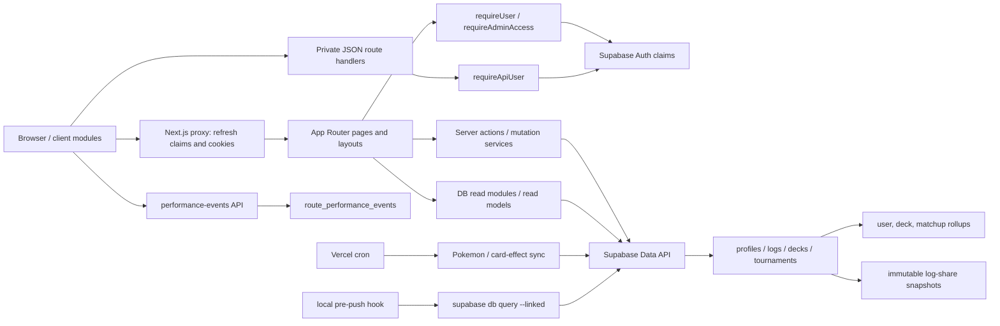

# PokeNotesV2 Application Health Review

- Date: 11 July 2026
- Documentation follow-up: 14 July 2026. Migration alignment, the 40-contract schema gate, 49/49 Deck List and 2/2 Matchup Plan parity, current catalog state, 318 repository tests, and the latest seven-day production RUM aggregates were rechecked. Statements tied to the original review remain explicitly dated rather than silently treated as live dashboards.
- Review status: Complete. The approved database-first remediation and application release are live; production data repair, schema contracts, application gates, and representative production journeys have been verified
- Production investigation policy: Initial evidence was gathered read-only. The owner then explicitly approved the security, tenant-integrity, collision re-key, 30-day compatibility, 256 KiB share limit, application deployment, and Vercel configuration changes recorded below
- Production changes made: All previously approved security/tenant changes plus the transactional Deck Aggregate writer, scoped preservation re-key, future-object privilege defaults, share envelope/size guards, approved-origin redirects, browser headers, runtime codecs, catalog boundaries, cache/accessibility/CI repairs, and scheduled-sync secret configuration
- Deliberately not changed: The Git/pre-push SQL route, legacy Deck Aggregate removal, leaked-password policy, legacy Supabase key model, CSP enforcement, and unapproved import/telemetry limits

## Executive summary

PokeNotesV2 now has a sound application-code baseline, a coherent product surface, and **no known critical live authorization path from this review**. The three confirmed critical findings were contained in production after an explicitly approved, staged security response:

- Public battle-log shares are read only through an exact-token database function. Anonymous callers can no longer SELECT or enumerate the share table, all pre-cutover links were revoked, new links expire after seven days, and a deletion-proof ledger enforces at most 50 new links per user in any rolling 24-hour period.
- Users can edit only Display Name, First Name, Last Name, PTCGL Username, and Profile Picture. The protected database `profiles.role` is now the sole admin authority; normal users cannot insert profiles or change role/system columns, and the database protects the final remaining admin.
- The former production test-login endpoint returns `404` for both GET and POST. Its four production Vercel variables were removed, the test-account credential was rotated, existing sessions and saved production browser state were revoked/removed. Localhost and explicitly allowlisted phone access remain available only in development; both require the current pairing code, which the saved-state tooling submits automatically for routine local checks.

In plain English, the normal product workflows remain: users can share a log, edit their profile, administrators can manage roles, and the owner can open localhost on a phone. What changed is the removal of alternative side doors that bypassed those intended workflows. Existing share URLs intentionally stopped working; newly created ones remain usable for up to one week.

The application is also materially healthier outside the original critical paths. Repairs provide typed `401` responses across private JSON APIs, prevent an infinite battle-log skeleton, enforce same-account parent relationships in the database, retain the newest bounded stats window, harden internal redirects, remove dependency advisories, enforce private local auth-file permissions, and address systemic accessibility/design issues in shared code. The Deck Aggregate now has one no-record-loss read rule and an all-or-nothing production writer. The approved re-key preserved all 19 Deck List and one Matchup Plan account-scoped copies, repaired 31 precisely scoped Battle Log links, left 43 unrelated same-ID links unchanged, and retained a private 20-row identifier-only rollback/compatibility ledger through 10 August 2026 at 23:08 UTC. The post-repair audit reports 49/49 Deck List and 2/2 Matchup Plan parity with no blocking condition.

Performance was healthy in the review's 11 July sample: `/logs` hard loads had 67 samples, p75 **426 ms**, p95 **652 ms**, and all sampled total-blocking-time values were **0 ms**. A 14 July follow-up over the preceding seven days found 83 `/logs` hard loads at p75 **540 ms** and p95 **3,564 ms**. That newer tail is outside the working target and warrants investigation, but the aggregate alone does not identify its cause. See [`docs/performance-targets.md`](./performance-targets.md) for the dated route table and measurement rules.

## Plain-English impact guide

### Changes already made

| Area | What changed | Practical effect | What still works the same |
| --- | --- | --- | --- |
| Public sharing | The database reveals a share only when the caller has the exact active token; old links were revoked; new links last seven days and each account can create 50 in a rolling day. | Someone cannot list every shared log, and deleting links cannot reset the creation allowance. Recipients of an old link need a newly generated one. | Creating a share still gives the owner a URL, and a recipient can still open a valid URL without an account. |
| Profiles and administrator access | Users can directly edit only the five agreed profile fields. Administrator status has one protected database source, and the final administrator cannot be removed accidentally. | A user cannot promote themselves by bypassing the screen, and role information cannot disagree between two copies. | Normal profile saves and approved role changes through the admin dashboard continue. |
| Login | The production shortcut login was removed, its configuration was deleted, the credential was changed, and old sessions/state were revoked. Every development login attempt now requires the current local pairing code, including requests claiming to be localhost; routine saved-state automation supplies it. | A copied production shortcut or a forged `localhost` request can no longer create an administrator session. | Normal Google login and administrator access are unchanged; supported local/phone testing remains available in development. |
| Auth redirects and browser headers | OAuth destinations now come only from configured/approved origins or exact development hosts; every route receives conservative anti-framing, content-sniffing, referrer, and browser-capability headers, and `X-Powered-By` is disabled. | A foreign `Origin` can no longer choose the post-login destination. Production returned the safe application login destination and the expected headers. | Existing authenticated production routes work. A fresh Google OAuth round trip and preview-host replay were not forced; CSP remains deliberately unenforced until it can be observed safely. |
| Database safety and speed | Repeated identity checks were made once per query, overlapping read rules were combined, ownership-preserving update checks were added, and parent/child links now include the account owner in validated foreign keys. | Less repeated database work. A direct API request can no longer attach a deck list, matchup, round, log, or tournament to another account's parent. No existing valid relationship was changed. | The same valid reads, saves, links, cascades, and optional deck unlinking remain valid. |
| Deck compatibility | Reads combine the legacy and relational copies without dropping a unique record, and saves now update both stores in one database transaction. Both account-scoped copies involved in the 19 list and one matchup collisions were preserved under fresh IDs. | A failed save cannot leave only half of the deck updated. Different-child edits merge under a lock; a stale same-child edit asks the later editor to refresh. The former collision-affected decks are writable again. | Deck screens and normal content are unchanged. Old bookmarks containing one of the 20 replaced child IDs no longer resolve; internal navigation and 31 stored log links were repaired. |
| Public-share payload protection | The established `v1` wrapper is validated and serialized snapshots are capped at 256 KiB. | All 71 stored payloads remained constraint-valid and below the cap; the largest was 52,396 bytes. An oversized custom/direct caller now gets a clear `413` instead of consuming unbounded storage. | Ordinary share creation/opening/revocation remains unchanged below the generous limit. Older links remain intentionally revoked by the earlier security cut-over. |
| Application reliability and accessibility | Loading failures now end with retry, private APIs return clear signed-out responses, shared colors/labels/skip navigation/mobile layout were repaired, and dependencies were updated. | Fewer endless loading screens, clearer errors, safer dependencies, and better keyboard/mobile/screen-reader use. | Product rules and stored user data were not intentionally changed by these repairs. |
| Migration history | All 15 local migration versions now match production. | Schema tooling has an honest, fully aligned starting point and the expanded health gate is green. | The owner-deferred Git/pre-push route remains unchanged. |

### Live and remaining security work: expected impact and breakage risk

The first four rows and the catalog network boundary are live. The remaining rows are controlled hardening projects, not switches to turn on without testing.

| Proposed change | Expected effect | Could it disrupt current work? | Safest implementation |
| --- | --- | --- | --- |
| Use only configured, approved destinations after login (SEC-04, live) | Stops a crafted request from sending an auth redirect to somebody else's site. | A missing hostname now fails closed or returns to the configured public app rather than trusting request input. | Keep every supported non-Vercel origin explicit and keep Supabase's callback allowlist aligned. Replay a fresh OAuth login when adding a new host. |
| Tighten default database privileges (SEC-06, live) | Prevents a future table/function from accidentally becoming callable just because its author forgot an explicit revoke. | A needed new backend function will fail clearly if its migration omits the intended explicit grant. Existing functions were not revoked. | Keep explicit grants beside each future function; the temporary rollback smoke proved implicit access is removed and intended access works after grant. |
| Add browser security headers (SEC-07 baseline, live) | Reduces framing, unsafe content interpretation, referrer leakage, and unexpected browser capability. | The baseline is low risk and production navigation passed. An overly strict CSP could still block legitimate scripts, images, or analytics. | Retain the live baseline. Add CSP only after a reporting destination exists and report-only violations have been reviewed. |
| Validate and cap public-share payloads (SEC-09, live) | Rejects a malformed or oversized direct database/API share before storing it and later serving a broken public page. | All 71 measured rows conform and none exceeded 52,396 bytes; ordinary callers should not notice. A custom caller above 256 KiB receives a stable `413`. | Monitor rejections without logging payload content. Change the limit only with new usage evidence and a support plan. |
| Add import/processing/event limits (SEC-09) | Protects database/storage/CPU capacity from accidental loops and deliberate abuse. | Yes: users above the chosen allowance would see a limit/retry response. Normal users below it should not notice. | Product owners choose limits and exception/support behavior from real usage; observe near-limit traffic before enforcement. Do not copy the share limit blindly to unrelated work. |
| Enable leaked-password protection (SEC-10) | Adds a warning/block for a password known to have appeared in a breach. | OAuth/Google users are unaffected. Password users may need to choose another password and may need support. | First confirm whether password login is an intended customer path, then enable with clear recovery guidance. |
| Move from legacy Supabase keys (SEC-11) | Uses the newer, narrower credential model and makes future secret rotation cleaner. | A missing or mismatched environment value can break a client or server deployment. | Inventory every local/preview/production consumer, introduce and verify new keys in preview, rotate in stages, and retain a tested rollback until production is healthy. |
| Constrain catalog network calls (SEC-12 boundary, live) | Stops a broken/hostile upstream response from holding a sync open, following redirects, returning an oversized body, or sending follow-up requests outside intended hosts/paths. | A catalog refresh may fail closed and leave older catalog data visible when an upstream response falls outside the new rules. | Keep atomic candidate publication and a whole-job Pokemon failure budget as separate work; the per-request boundary does not make an in-place sync transactional. |

### Measured limit recommendations — share cap implemented; others proposed

The repository now contains one repeatable, SELECT-only aggregate query at `docs/production-usage-limit-evidence.sql`. Its 11 July snapshot covers three users and returns no identifiers, tokens, names, notes, paths, log text, or card content. That is enough to propose generous starting points, but not enough to treat them as settled product policy. A monitor-first period and a supported exception path should precede hard enforcement.

| Area | Aggregate production evidence | Recommended starting boundary | Effect if later approved |
| --- | --- | --- | --- |
| Share snapshot size | 71 snapshots; median 21,394 bytes; largest 52,396 bytes. | **Live:** 256 KiB serialized JSON, nearly five times the observed maximum. | All stored payloads remained valid under the new constraint. A malformed/custom caller trying to store an unusually large public snapshot receives a clear `413` rejection. |
| Import body size | 807 logs; largest raw log 21,903 bytes; largest raw-plus-parsed-sections representation 72,393 bytes. | 128 KiB for submitted raw log text. | Normal observed imports remain unchanged; accidentally pasted files or deliberately oversized submissions fail before expensive parsing/storage. The limit is not implemented. |
| Import frequency | Historical maximum 16 imports per active user-day; last-30-day maximum 9. | Warn/observe at 50 per day and provisionally stop at 100 per rolling 24 hours. | Routine use remains far below the boundary. A legitimate history migration above 100 would need an explicit bulk-import/admin route; whether to support that is a product decision. |
| Performance telemetry | Production maximum 92 events per active user-hour and 151 per active user-day; local automation is materially noisier. | Observe at 150/hour or 400/day; sample/drop above 200/hour or 500/day. Exempt or separately sample local/preview traffic. | Measurement noise and abuse stop consuming unbounded storage. Telemetry must fail silently and must never block the user's action. |
| Deck List input | 49 legacy occurrences and 30 relational rows; largest raw list 1,021 bytes/38 non-empty lines; largest parsed array 34 entries/3,166 bytes. | 16 KiB raw text, 128 parsed/sorted entries, and 64 KiB per derived array. | Every observed list remains well inside the boundary; only extreme/malformed input is rejected. These limits are recommendations, not code. |

### Overall health assessment

Scores use a 1–5 review scale, where 1 is unsafe/fragile and 5 is strong. They are a prioritization aid, not a production SLO.

| Discipline | Score | Assessment | Basis |
| --- | ---: | --- | --- |
| Security and authorization | 4/5 | Strongly improved | All three critical paths, tenant parent integrity, origin/header baseline, future default grants, and share envelope/size protections are live. CSP, leaked-password policy, legacy-key migration, and broader abuse budgets remain. |
| Architecture and maintainability | 3/5 | Mixed | Clear App Router/data-module boundaries and no import cycles; dual persistence and repeated mutation interfaces weaken locality. |
| Correctness and resilience | 4/5 | Materially improved | Strong tests/read models, live transactional deck writes, repaired historical collisions, and log/share runtime codecs; tournament/bulk atomicity, catalog publication, and broader deck JSON validation remain. |
| Performance | 3.5/5 | Improved, with a tail to investigate | The 11 July sample was healthy, while the 14 July seven-day follow-up shows `/logs` and several low-volume hard-load p95s outside target. Route payloads remain deliberately deferred; RLS init-plan, duplicate-policy, and missing-FK-index advisor findings are fixed, leaving only 11 informational unused-index observations in the final live check. |
| UI, accessibility, and responsiveness | 3.5/5 | Good, improved | Shared design system, responsive sampled routes, and systemic fixes landed; headings, picker groups, and target sizing remain. |
| Engineering and deployment readiness | 3.5/5 | Good, with delivery debt | Lint/typecheck/318 tests/design/build are green; CI includes design audit; all 15 migrations align and schema health passes 40 security contracts. The owner has deferred pre-push changes, and protected live-schema CI remains. |
| **Overall** | **3.6/5** | **Materially healthier** | No known critical live path remains; the highest-risk approved architecture and security cut-overs are complete, while the newer performance tail and several deeper consistency and operational projects remain. |

## Outcome summary

### Fixed now

Items 1–30 are implemented in the released application or production database. Item 31 was discovered during the first production replay and is included in the final follow-up release. Items 13–19, 21, 24, 29, and 30 intentionally changed production authorization, credentials/sessions, relationship enforcement, future privilege defaults, collision identifiers/links, and share validation/limits under explicit owner approval. The ordinary product workflow was preserved; the intentional visible exceptions are identified below.

1. **Medium — Private APIs now return typed, private/no-store `401` responses.** `lib/server/api-auth.ts`, `lib/server/api-response.ts:18-36`, and ten private route modules replace page-style redirect exceptions that were previously caught as generic `500` responses. `tests/api-auth.test.ts` covers the response and route contract.
2. **Medium — Deferred battle-log body failures now terminate in an explicit error/retry state.** `components/ui/BattleLogDetailShell.tsx:132-187` handles HTTP, network, and JSON failures; `components/ui/BattleLogDetailView.tsx:725-746` renders an accessible alert, retry action, and shared Skeleton state.
3. **High — Tournament round application mutations are better parent-scoped.** `app/(app)/tournaments/actions.ts:588-610` verifies tournament ownership before saving a round, and `:677-684` scopes deletion by round, tournament, and user. The live composite ownership constraint now backs this application defense at the database boundary.
4. **Medium — The stats damage timeline retains and honestly labels the newest bounded window.** `lib/db/logs.ts:492-517` queries the newest 5,000 rows and reverses the selected window for chronological display. If a user exceeds the cap, the chart now says “Latest 5,000 games,” retains the all-time game numbers, and computes chart totals from that displayed window.
5. **Low — Internal redirect validation rejects backslashes and control characters.** `lib/server/action-redirect.ts:1-16` now rejects ambiguous path forms in addition to absolute and protocol-relative targets.
6. **High — Systemic contrast tokens and status text were repaired.** `app/globals.css:18-66,143-201` now gives muted/kicker and win/loss/warning text reviewed values; shared variants and direct text consumers use the strong semantic tokens. Page, card, and muted base-surface pairs measure at least 4.70:1. The design audit now rejects weak status/destructive text classes.
7. **High — Keyboard users can bypass repeated shell navigation.** `components/ui/AppShell.tsx:22-39` adds a visible-on-focus skip link to the shared `SidebarInset` main target.
8. **Medium — The `/decks` toolbar no longer relies on more than 320 px.** `components/ui/DeckStrategyCollection.tsx:131-151` stacks controls below 360 px and adds `min-w-0` containment.
9. **Medium — Reduced-motion and calculator states are accessible.** `app/globals.css:347-356` honors reduced-motion preference. The calculator now has a visible loading Skeleton/status, an initial screen-reader `h1`, alert semantics, and stable memo inputs (`components/calculator/LazyProbabilityCalculator.tsx:7-25`; `components/calculator/ProbabilityCalculator.tsx`).
10. **Medium — Seven inline strategy/matchup textareas now have programmatic labels.** `InlineDeckStrategyEditor` and `InlineDeckMatchupEditor` use `Field`, `FieldLabel`, `useId`, and matching `htmlFor`/`id`. Routine autosave states use polite status regions, failures use one assertive alert, and `AdminRoleControls` announces pending/error state with a per-instance accessible relationship. `tests/inline-editor-accessibility.test.ts` has four focused regression tests.
11. **Medium — Local auth material is private by default.** Local environment and saved browser-auth files are created or corrected to mode `0600` in `scripts/setup-local-test-login.mjs`, `scripts/save-local-auth-state.mjs`, and `scripts/perf-prod.mjs`. Existing local files were corrected without displaying their contents.
12. **High — Known dependency advisories were removed.** The lockfile was refreshed and `tsx` moved to `^4.23.0`. Both current `npm audit --json` and `npm audit --omit=dev --json` report zero advisories.
13. **Critical — Public shares now require possession of the exact token.** `lib/db/log-shares.ts` reads through `get_active_log_share` and creates through `create_log_share`; production `anon` has no table SELECT and `authenticated` has no direct INSERT. Existing links were revoked, new links last seven days, and a private creation ledger makes the rolling 50-per-24-hours limit survive deletion. A temporary active test share proved token access and was then removed.
14. **Critical — Profile self-promotion is closed and the database role is authoritative.** Direct authenticated profile INSERT is disabled; only `display_name`, `first_name`, `last_name`, `ptcgl_username`, and `avatar_color` remain directly editable. Role and auth-derived/system columns are blocked. Shared navigation and admin guards read the database profile role, and `set_profile_role` transactionally protects the final admin. A normal authenticated save through the local app against live Supabase was verified after lockdown.
15. **Critical — Production test-login has been removed as a credential path.** `/auth/test-login` returns a private/no-store `404` for GET and POST. Four Vercel variables were removed, the associated credential was rotated, sessions revoked, and saved production test state deleted.
16. **Medium — Localhost and phone testing now use a paired development-only login.** The local route is POST-only, disabled outside development, restricts Host/Origin/fetch-site, and requires a timing-safe pairing code for every request, including loopback. Automation supplies the code through the form; phone access uses the code copied from the Mac, and neither path places a bearer secret in a URL.
17. **Medium — Live RLS and foreign-key performance debt was repaired.** Thirty-four `auth.uid()` policy checks are now cached once per statement, four UPDATE policies preserve ownership with `WITH CHECK`, route-performance SELECT policies are consolidated, and the required foreign-key indexes were added. Supabase performance advisors fell from 64 notices to 11 informational unused-index observations in the final live check, with no remaining unindexed-FK, auth-initplan, or multiple-policy warning.
18. **Medium — All 15 migrations match live history exactly.** `supabase migration list --linked` aligns every local/remote version, including the Deck Aggregate transaction, future default privileges, share envelope, scoped re-key, and 256 KiB size guard. This gives future tooling an honest starting point and does not change the owner-deferred pre-push execution route.
19. **High — Parent and child records now remain in the same account at the database boundary.** A read-only preflight found zero ownership mismatches. Eight validated constraints now make `(user_id,parent_id)` authoritative for Deck Lists, Matchup Plans, tournament rounds, linked decks, and deck rollups; four log/tournament policies also require any compatibility list ID to exist inside the signed-in user's owned deck. The two advisor-identified child indexes were added, generated Supabase types now describe the composite relationships, and the final live verification found eight validated constraints, four scoped policies, zero superseded ID-only constraints, and zero ownership mismatches.
20. **High containment — Partial deck migration can no longer hide a unique legacy child on the migrated collection, selection, and detail reads.** `lib/decks/aggregate-compatibility.ts` defines one no-record-loss precedence rule used by `lib/db/decks.ts`; six focused tests cover fully migrated, partial, relational-only, duplicate-ID, fallback, and matchup cases. `npm run audit:deck-compatibility` performs paginated SELECT-only comparison and emits aggregate counts only. `CONTEXT.md` and ADR 0001 record the account/deck-scoped identity invariant and prohibit an unreviewed data discard or re-key. Item 24 supplies the live atomic writer; deck/admin aggregate counts still use the larger store total rather than a union of scoped child identities `(user_id, deck_id, child_id)`.
21. **Medium — Deck deletion cannot leave a half-linked list reference.** `clear_orphaned_deck_list_link` runs before every log/tournament insert or update—including foreign-key unlink actions—and clears the list ID whenever the deck ID becomes null. Two validated checks make that invariant unavoidable. Live verification found both triggers active, both checks exact/validated, zero half-linked rows, and no anonymous/authenticated direct execution privilege. This preserves normal unlinking while preventing a later unrelated save from failing on stale link state.
22. **Medium — Authentication redirect destinations are approved rather than request-controlled.** `lib/server/app-url.ts` ignores the incoming `Origin` as destination authority, matches request host/protocol only against configured origins, accepts Vercel's server-provided current deployment and branch URLs, and permits exact paired-development hosts only while in development. Eleven focused tests cover foreign Origin/forwarded-host input, explicit preview and Vercel origins, localhost/LAN preservation, normalization, and fail-closed behavior. A hostile production callback probe returned the safe application login destination.
23. **Medium — Conservative browser response headers are centralized and live.** `next.config.js` disables `X-Powered-By` and applies `X-Frame-Options: DENY`, `X-Content-Type-Options: nosniff`, `Referrer-Policy: strict-origin-when-cross-origin`, and a camera/geolocation/microphone `Permissions-Policy` to all routes. Production `/login` carried all four headers without `X-Powered-By`. CSP remains intentionally deferred until reports can be collected and the resource inventory observed.
24. **High — Deck List and Matchup Plan writes are transactional in production.** `commit_deck_aggregate_child` is an authenticated, RLS-preserving RPC that locks the owned parent, merges against the latest Legacy Deck Copy, version-checks same-child edits, rejects ambiguous IDs, and commits both stores together. The approved scoped migration preserved both account copies by re-keying 19 Deck List and one Matchup Plan occurrences, repaired 31 owner/deck-scoped Battle Log links, left 43 unrelated same-ID links untouched, and retained a private 20-row mapping ledger. Post-repair parity is 49/49 lists and 2/2 matchups with no blocking issue.
25. **Medium — Stored/imported Battle Log and public-share JSON is checked at runtime.** Shared codecs validate nested sections, Battle Log snapshots, and optional Deck Cards. A malformed stored log falls back to an empty detail with a sanitized report; a malformed public snapshot fails closed; and missing/malformed submitted sections are rejected before import while literal `[]` remains valid. Compact share tokens are redacted even when an upstream error embeds one in its message. Broader deck/matchup historical codecs remain outstanding.
26. **Medium — Catalog network and catastrophic-empty-run boundaries are explicit and deployed.** Both syncs use one HTTPS host/path allowlist with redirect denial, streaming byte limits, and abort timeouts; page/identity metadata must remain consistent. The card sync blocks stale-row deletion unless unique valid card identities equal the advertised total, the Pokemon list cannot end before the current 1,025-species boundary, and malformed evolution-chain maps are rejected per species. In-place partial publication and a whole-run Pokemon failure budget still require the staged-catalog project.
27. **Medium/low — Several review quick wins are released.** CI runs `design:audit`; error pages no longer promise durable monitoring that does not exist; the shared sprite picker has an accessible group name/instructions; and log, match, profile, and deck-detail heading outlines were repaired without visual redesign. Four regression checks cover these contracts.
28. **Medium containment — Editor option module caches now have a freshness and account-safety contract.** The unused, tenant-specific tournament-editor payload cache was removed instead of trying to invalidate or account-key it. The remaining public Pokemon option cache uses one shared async TTL primitive and the existing one-hour server freshness window; it deduplicates concurrent requests, notifies subscribed mounted consumers on expiry/invalidation, cannot restore an invalidated in-flight result, and never caches failures. The tournament editor uses that subscribed resource and retains an explicit retry path. Five focused tests cover expiry, subscriptions/invalidation, races, retryability, and removal of tenant editor data from the client cache.
29. **Medium — Future database interfaces require deliberate grants.** The live migration changes only later `postgres`-owned public-schema objects; it revoked no current table/function permission and rewrote no row. Public table/sequence/function role defaults are opt-in, while a tightly scoped DDL trigger removes PostgreSQL's implicit `PUBLIC` routine execution immediately after an application-owned, non-extension routine is created/replaced so a later explicit `GRANT` remains authoritative. A rollback-only production smoke created a temporary routine, proved implicit access absent, proved explicit authenticated access after grant, and removed the fixture.
30. **Medium — Malformed or oversized public-share wrappers are rejected before storage.** The validated constraints accept the stable `v1` wrapper used by all 71 observed rows, permit extra/deeper fields, and cap serialized payloads at 256 KiB. Isolated and rollback-only production probes accepted valid variants, rejected malformed variants, and returned the stable oversized condition that the API maps to `413`. All stored payloads remained constraint-valid and below the cap; the observed maximum was 52,396 bytes.
31. **Medium — Deck dates now hydrate deterministically at the UK calendar boundary.** Production verification found React error `#418` on `/decks`: Vercel rendered a `23:02 UTC` update as 13 May while a UK browser rendered 14 May. `lib/date-time.ts` now defines one `Europe/London` calendar formatter, `DeckCard` uses it in both layouts, and import-date parsing reuses the same time-zone constant. A boundary regression proves the exact timestamp renders 14 May even when the test host runs in UTC.

### Confirmed findings still outstanding

- High: ENG-01 pre-push remote SQL deployment, ARC-01 legacy Deck Aggregate retirement/count cut-over after observation, ARC-02 tournament/deck-list multi-write consistency, and COR-01 post-mutation bulk count checks.
- Medium: a measured CSP rollout, import/processing/performance-event budgets, atomic catalog publication, a whole-job Pokemon failure budget, broader deck/historical JSON validation, remaining non-subscribed component-lifetime editor snapshots, protected live-schema CI coverage, durable observability, remaining accessibility semantics, and behavioral test depth.
- Low: leaked-password protection, legacy API key migration planning, and duplicated mutation-client mechanics.

### Product and operational decisions required

- **Owner decision recorded:** leave the current Git/pre-push SQL route unchanged for now. ENG-01 remains documented debt, not an unmade product decision.
- Final removal approval for the temporary deck JSON compatibility adapter after 10 August 2026 at 23:08 UTC and only after ADR 0001's clean-audit/reader/writer exit checks pass. The 30-day minimum is approved and running; removal is not automatic.
- Product approval for the remaining monitor/hard boundaries in the measured-limit table, especially whether legitimate history onboarding may exceed 100 imports per day and what support/override route should exist. The share count/lifetime/256 KiB decisions are complete and live.
- Whether catalog/tournament/bulk operations may add further RPCs or staging tables, and the acceptable whole-job catalog failure budget.
- Whether password login is an intended user path before enabling leaked-password protection, plus the staged plan/timing for moving from legacy Supabase keys.
- A shared 44 px interaction-target standard where increasing compact controls affects information density.

### Items not verified

- Production-data mutations were limited to the explicitly approved security response, scoped collision repair, and narrow verification. The re-key changed identifiers only for 19 Deck List and one Matchup Plan account-scoped copies and 31 matching Battle Log links; snapshot assertions proved content/timestamps unchanged and 43 unrelated same-ID links untouched. Broad create/edit/delete/import/admin/cron journeys were not replayed through the production UI.
- The original critical paths were not exploited beyond the minimum evidence needed to confirm them; no share payload content or personal data was displayed. Post-cutover role/grant/function probes confirmed that the bypasses are closed.
- An authenticated production session opened top-level routes, a real deck detail, a real matchup detail, and a real Deck List dialog without retaining or printing private content. Not every dynamic log/tournament record was opened. Public token access was verified with temporary test data that was removed.
- A complete keyboard-only, screen-reader, and every-route dark/light visual pass remains outstanding.
- Route bundle attribution was not available; no bundle analyzer report was generated.
- Upstream partial-failure behavior for the two catalog syncs was not invoked in production.
- The future-routine trigger and oversized-share guard were executed only inside explicit production transactions that were rolled back after their assertions; no fixture remained.
- A fresh interactive Google OAuth round trip and a supported preview-host callback were not forced. The existing authenticated production session and hostile-Origin callback fallback were verified.
- The automated production performance harness stalled without useful output and was stopped after more than 90 seconds; read-only RUM queries and manual route checks were used instead.
- The production security/database deployment and representative signed-in/read-only journeys were verified. Write-heavy UI journeys still rely primarily on transaction probes, automated tests, and local/browser gate evidence rather than mutation of real production records.

## Scope and method

### Repository scope

The final working-tree inventory covered 415 repository files, including:

- 16 page modules, 3 layouts, 17 route handlers, and 6 action modules under `app/`;
- 99 shared/component files and 95 library/data/domain files;
- SQL/schema files, Git hooks, scripts, CI, Next.js, TypeScript, ESLint, Tailwind, and Vercel configuration;
- 54 current test files and 318 passing tests, including security-boundary, deck transaction/re-key/aggregate, share-size, deterministic-date, catalog-boundary, client-cache, accessibility, basic-Energy ordering, and focused regression coverage added during and after remediation.

Static work combined repository-wide inventory/searches with focused reads of every significant route group, mutation boundary, shared shell/design primitive, auth/Supabase adapter, catalog sync, SQL policy/grant surface, configuration gate, and test area. The baseline import analysis covered 235 source modules and 747 static imports with no cycle; the added modules retain one-way domain/server boundaries and the final typecheck/build both pass.

### Evidence standard

A finding is marked confirmed only when supported by one or more of:

- source code and an affected file/line range;
- an existing or added automated test;
- a validation command and exit status;
- a read-only live Supabase metadata, privilege, aggregate, or advisor query;
- a read-only production header/origin probe;
- visible behavior in an authenticated production browser session;
- production RUM from `route_performance_events`.

Initial production probes deliberately selected minimal columns and performed no writes. One anonymous payload probe confirmed only that an object was returned and measured its serialized size; the content and personal data were not displayed or inspected. After owner approval, the scoped remediation changed share/profile/login configuration and used minimal temporary verification data. The tenant-integrity phase used aggregate-only preflight and post-migration introspection; the deck compatibility command remained SELECT-only and printed counts rather than records. All unrelated production investigation remained read-only.

## Architecture map and major data flows

### Module and boundary map

| Boundary | Primary implementation | Responsibilities and data flow | Assessment |
| --- | --- | --- | --- |
| Authentication/session | `proxy.ts`, `lib/auth.ts`, `lib/server/auth-claim-header.ts`, local pairing helpers | Refresh claims/cookies, derive current user, protect page routes, allow explicitly paired development devices. | Production bearer login removed; local/phone testing remains available behind development, host/origin, and pairing boundaries. |
| API authentication | `lib/server/api-auth.ts`, `lib/server/api-response.ts` | Convert missing session to typed private/no-store `401`. | Fixed and covered across ten private APIs. |
| Page/read models | `app/(app)/**/page.tsx`, `lib/db/*.ts` | Server-render summaries, stream/defer heavier data, map database rows to UI types. | Generally strong; runtime JSON codecs are shallow. |
| Mutations | `app/(app)/**/actions.ts`, `lib/decks/deck-aggregate-writer.ts`, thin list/matchup services | Validate forms, enforce user scope, plan deck child writes, write entities, revalidate routes. | Deck list/matchup coordination and transaction are centralized; broader repeated client submission mechanics remain. |
| Deck aggregate | compatibility resolver/writer/RPC, `decks`, `deck_lists`, `deck_matchups`, tournament links | Relational children coexist with JSON arrays on `decks` behind explicit read/write transition boundaries. | Read loss, transactional writes, and historical collisions are contained live; count cut-over, observation, and legacy retirement remain. |
| Battle logs/stats | parser modules, `lib/db/logs.ts`, SQL rollups | Parse PTCGL text, persist logs, produce overview/deck/matchup read models. | Good read-path architecture; bulk writes and runtime nested data need hardening. |
| Public shares | `lib/db/log-shares.ts`, `/s/[token]`, `/shared/[token]`, share RPCs/ledger | Create an immutable seven-day snapshot through a rate-limited RPC and render only an exact active token. | Deep token boundary now enforced live; no anonymous table SELECT or authenticated direct INSERT. |
| Catalogs | `lib/*-catalog/sync.mjs`, cron routes, server cache | Pull upstream data, publish reference tables, invalidate cache. | Partial publication can be reported as success or delete good data. |
| Admin | `lib/db/admin.ts`, profile/admin RPCs, admin actions/layout | Database-profile role authorization, overview RPC/fallback, protected role mutation. | Database role is authoritative and final-admin protection is transactional; broader admin testing/observability still has room to deepen. |
| Design system | `components/shadcn`, shared UI, `app/globals.css` | Semantic tokens and reusable primitives across themes/sizes. | Strong base; this review moved several issues into shared fixes. |
| Delivery | `.githooks`, `scripts/git-hooks.mjs`, CI, Vercel | Local gates, remote schema deployment, build/deploy configuration. | Quality gates are useful; database mutation from pre-push is unsafe. |

### Major data flows

1. **OAuth/login:** auth route -> Supabase session -> proxy claim refresh -> signed claim header -> `requireUser`; admin routes additionally read `profiles.role`.
2. **Battle-log import:** form -> parser/language/player/stat modules -> `logs` row -> database rollups -> `/logs`, `/stats`, and linked-deck read models.
3. **Deck editing:** form -> thin list/matchup adapter -> typed `DeckAggregateWriter` -> live `commit_deck_aggregate_child` RPC -> locked relational + compatibility JSON transaction -> route revalidation.
4. **Tournament deck list:** tournament -> optional backing deck creation -> deck-list dual write -> tournament link update.
5. **Public share:** owner action -> authenticated `create_log_share` RPC -> seven-day immutable snapshot + rolling-window ledger -> anonymous exact-token `get_active_log_share` RPC -> public render.
6. **RUM:** browser observer -> authenticated, clamped API event -> `route_performance_events` -> read-only production analysis.
7. **Reference catalogs:** authorized cron -> upstream API -> batched live-table writes -> cache invalidation.
8. **Schema delivery:** changed `sql/*.sql` -> local pre-push -> direct linked-project execution -> custom hash ledger.

## Findings by discipline and severity

## Security, authentication, authorization, and abuse

### Critical

#### SEC-01 — Anonymous Data API callers could enumerate complete share snapshots

- **Status:** Fixed live.
- **Original evidence:** Before containment, `anon` had table/payload SELECT and a universal `USING (true)` policy. Aggregate-only inspection found 68 rows: 22 active and 46 expired. No payload content or personal data was displayed.
- **Remediation:** `lib/db/log-shares.ts:226-243` now reads only through `get_active_log_share` and creates only through `create_log_share`. The locked-down production role has `anon` table SELECT **false** and authenticated direct INSERT **false**. The token function has a fixed empty `search_path`, returns no owner identifier, and checks exact token plus expiry. All pre-cutover links were expired/revoked. `private.log_share_creation_events` preserves creation history independently of deletions, enforcing 50 new links per rolling 24 hours; the database forces a seven-day expiry.
- **Live proof:** An anonymous direct table probe was denied, a nonexistent token returned no row, a temporary valid token returned only its matching active snapshot, and the test row was then removed. `npm run schema:health` asserts the table/function permissions as part of 29 live security contracts.
- **Effect:** Ordinary sharing still produces a link that its recipient can open. Existing links intentionally stopped working, new links last no more than one week, and neither anonymous enumeration nor delete-and-recreate quota bypass remains available.

#### SEC-02 — Authenticated users could promote their own profile to admin

- **Status:** Fixed live.
- **Original cause:** Row-level security limited users to their own row, but table-wide UPDATE still included the server-owned `role` column.
- **Remediation:** Authenticated direct profile INSERT is now false. Direct UPDATE is granted only for `display_name`, `first_name`, `last_name`, `ptcgl_username`, and `avatar_color`; `role`, email, identity, activity, login, and timestamp columns are blocked. Profile synchronization/activity use protected RPCs (`lib/db/profile.ts:99-120`), shared navigation and admin guards read `profiles.role` (`app/(app)/layout.tsx:11-23`, `lib/db/admin.ts:267-304`), and only the service-role path can call `set_profile_role` (`lib/db/admin.ts:578-598`).
- **Live proof:** Column/table privilege probes passed, a standard authenticated localhost profile save succeeded against live Supabase after lockdown, the role was unchanged, and one administrator remains. The role RPC uses a database advisory lock and rejects demotion of the final admin.
- **Effect:** Users retain every agreed profile-editing workflow. They cannot change security clearance by calling Supabase directly; administrator changes continue through the protected admin dashboard and database role function.

#### SEC-03 — Production test-login was a bearer path to an admin session

- **Status:** Fixed live.
- **Remediation:** `app/auth/test-login/route.ts:1-27` now returns a private/no-store `404` for both GET and POST in every environment. The four associated Vercel variables were removed, the test-account credential was rotated, its sessions were revoked, and saved production browser authentication state was deleted.
- **Live proof:** Production GET and POST both returned `404`; a production deployment is serving the disabled implementation. The route contract is also covered by `tests/local-test-login.test.ts:20-25`.
- **Effect:** Normal Google login and administrator access are unchanged. The old production automation link no longer works. Localhost and phone development testing use the paired development-only flow described in SEC-08 instead.

### Medium

#### SEC-04 — Request-controlled `Origin` can poison authentication redirects

- **Status:** Fixed and deployed; fresh Google OAuth/preview-host replay remains unforced.
- **Original evidence:** The pre-fix production callback probe with a controlled foreign `Origin` returned a `307` whose location used that origin.
- **Repair:** `lib/server/app-url.ts` no longer uses `Origin` as destination authority. Request host/protocol must match `NEXT_PUBLIC_APP_URL`, `POKE_NOTES_AUTH_REDIRECT_ORIGINS`, Vercel's server-provided deployment/branch/production origins, or—only in development—an exact local-login host. Unapproved input falls back to the configured public origin or fails closed when no safe origin exists.
- **Effect:** Normal configured production and preview destinations remain available. Localhost and allowlisted phone hosts remain available in development. A forgotten non-Vercel preview hostname can no longer be trusted implicitly, so it must be configured and registered in Supabase Auth before login will complete there.
- **Regression evidence:** `tests/app-url.test.ts` has eleven focused cases, including the original foreign-Origin shape, forged forwarded host, explicit preview, Vercel deployment/branch previews, loopback/LAN preservation, invalid scheme filtering, and fail-closed behavior. Production carrying a foreign `Origin` redirected to the safe application `/login`, not the supplied site.
- **Remaining verification:** Replay a fresh Google OAuth round trip and any supported preview hostname when changing the origin/callback configuration. The existing authenticated production session remained valid across the release.

#### SEC-05 — Tenant ownership was not enforced across parent/child foreign keys

- **Status:** Fixed now and verified live.
- **Evidence:** A SELECT-only preflight found zero owner/parent mismatches across `deck_lists`, `deck_matchups`, `tournament_rounds`, `deck_log_stats`, log deck links, and tournament deck links; every existing compatibility list link also resolved inside its owner's deck JSON. Migrations `20260711172840_enforce_tenant_parent_ownership.sql` and `20260711173032_index_tenant_parent_foreign_keys.sql` add and validate eight owner-aware uniqueness/foreign-key constraints, replace six ID-only parent keys, require list links to resolve within the caller's owned deck, and cover the two newly reported child-key indexes. Live introspection found 8/8 constraints validated, 4/4 scoped write policies, zero old ID-only constraints, and zero post-migration mismatches. Schema health makes these part of the repeatable gate.
- **Impact removed:** An authenticated Data API client can no longer attach its own child/link to another account's parent by supplying a known ID. Valid current relationships were not rewritten, and existing cascade or optional unlink behavior is retained.
- **Underlying cause repaired:** Parent identity now includes the account owner instead of relying on separate `user_id` and parent-ID checks.
- **Durable boundary:** Keep composite owner/parent constraints and compatibility list-link policies until list IDs have been safely re-keyed and a relational list foreign key can replace the JSON membership check.

#### SEC-06 — Live default grants and security-definer exposure exceed least privilege

- **Status:** Default-privilege cleanup is live and verified.
- **Evidence fixed:** Share/profile/admin RPC execution is now explicitly granted by role, `rls_auto_enable` is not executable by anonymous or authenticated roles, and the two mutable helper search paths are pinned (`supabase/migrations/20260711163935_harden_helper_functions.sql`). The expanded schema gate asserts these and related function/table contracts live.
- **Confirmed live cause:** A SELECT-only PostgreSQL 17.6 inspection found that the linked query/migration session runs as `postgres`; all 21 current public functions and all 16 current public relations are also owned by `postgres`. That creator's public-schema defaults grant every table and sequence privilege plus function `EXECUTE` to `anon`, `authenticated`, and `service_role`. PostgreSQL also hard-wires function `EXECUTE` to `PUBLIC` when no global override exists. The session can manage `postgres` defaults but is not a member of `supabase_admin`, whose separate public defaults therefore cannot be safely changed by this application migration.
- **Live repair:** Migration `20260711203447_harden_public_schema_default_privileges.sql` changes only later `postgres`-owned public-schema objects; it revoked no current object grant and rewrote no row. Future public tables, sequences, and direct API-role function grants become explicit. [PostgreSQL documents that a schema-scoped default revoke cannot subtract its built-in global `PUBLIC` function grant](https://www.postgresql.org/docs/17/sql-alterdefaultprivileges.html), so the migration deliberately avoids a global default change. Instead, a `ddl_command_end` trigger examines [PostgreSQL's schema-qualified DDL records](https://www.postgresql.org/docs/17/functions-event-triggers.html) and revokes the implicit routine grant only for application-owned, non-extension functions/procedures/aggregates created or replaced in `public`; later explicit `GRANT` statements remain effective. Non-public, extension-script, and other-owner platform routines are ignored. [Supabase documents that its `postgres` role can manage event triggers through the installed Supautils boundary](https://supabase.com/docs/guides/database/postgres/event-triggers).
- **Workflow effect and rollback:** Current user, admin, share, catalog, extension, and service-role access remained unchanged. A later migration that creates or replaces an intended public Data API routine must explicitly grant its caller after the `CREATE`; forgetting that grant produces a clear permission failure instead of exposure. The migration contains inverse future-default statements plus event-trigger/function removal and notes that objects created—or routines replaced—during a hardened interval retain their explicit ACLs for separate review.
- **Verification and residual:** Six focused source tests prove canonical-schema parity, current-object preservation, public-only/non-extension/owner scope, table/sequence/routine coverage, rollback notes, and linked schema-health contracts. A production rollback-only smoke created a temporary public routine, proved implicit anonymous/authenticated access absent, added the intended authenticated grant, proved it callable, and removed the fixture by rollback. Broad `supabase_admin` defaults remain platform-owned residual state; the migration deliberately ignores rather than pretending to harden that creator.

#### SEC-07 — Production responses lack a complete browser security-header policy

- **Status:** Baseline fixed and production-verified; CSP remains.
- **Original evidence:** The sampled production `/login` response included HSTS but lacked CSP/frame-ancestors, X-Frame-Options, X-Content-Type-Options, Referrer-Policy, and Permissions-Policy; it exposed `X-Powered-By`.
- **Repair:** `next.config.js` now disables `poweredByHeader` and centrally applies `X-Frame-Options: DENY`, `X-Content-Type-Options: nosniff`, `Referrer-Policy: strict-origin-when-cross-origin`, and `Permissions-Policy: camera=(), geolocation=(), microphone=()` to every route.
- **Effect:** Ordinary navigation, OAuth redirects, images, clipboard use, and application data behavior are not restricted by this baseline. The app cannot be framed, browsers are told not to MIME-sniff responses, cross-site referrers reveal only the origin, and three unused sensitive capabilities are disabled.
- **Regression evidence:** `tests/security-headers.test.ts` asserts the global rule, exact values, disabled framework disclosure, and absence of an unreviewed enforcing CSP. Production `/login` carried all four headers and omitted `X-Powered-By`.
- **CSP decision:** No CSP—enforcing or report-only—was added yet. An enforcing policy could break legitimate scripts/images. A report-only policy without a collection endpoint would create browser noise without reviewable evidence. Add a sanitized reporting destination first, inventory required resource origins, observe report-only violations, then enforce the smallest proven policy.
- **Remaining verification:** Confirm product intent before ever allowing legitimate third-party embedding; otherwise retain `DENY` as the long-term frame policy.

#### SEC-08 — Development login needed pairing on every allowed host

- **Status:** Fixed now.
- **Evidence:** `lib/server/local-test-login.ts:38-124` disables the flow outside development, restricts loopback/explicitly configured hosts, validates same-origin/fetch-site requests, and timing-safely verifies a pairing code for every local login attempt. `app/auth/dev-login/route.ts:28-110` is POST-only and returns private/no-store failures. `tests/local-test-login.test.ts` covers production disablement, forged loopback headers without a code, valid paired loopback/phone access, foreign/unlisted requests, and missing pairing configuration.
- **Effect:** The owner can still use automated localhost checks and open localhost from a phone. Automation submits the locally stored code in the form, while a person pastes it when needed. A page that merely forges localhost Host/Origin values cannot silently obtain the test session, and the code is never put in a URL.

#### SEC-09 — Expensive/storage-producing paths have no per-user abuse budget

- **Status:** Partially fixed; share count/lifetime, the stable `v1` payload envelope, and the approved 256 KiB size guard are live. Non-share processing budgets still require product limits.
- **Evidence fixed:** Authenticated direct share INSERT is false. `create_log_share` plus the private deletion-proof ledger enforce 50 new links per rolling 24 hours and seven-day expiry. Existing active-link reuse does not consume a new slot, and the API returns a typed `429` limit response. The privacy-safe live query in `docs/production-usage-limit-evidence.sql` found 71 shares, a largest serialized payload of 52,396 bytes, 71/71 matching the proposed envelope, and a historical maximum of 11 shares per active user-day versus the live allowance of 50.
- **Live repair and effect:** `20260711204150_enforce_log_share_payload_envelope.sql` validates the stable wrapper: object payload, `v1`, object log, array `log.sections`, string strategy label, and optional sorted cards absent/JSON-null/array. `20260711224858_enforce_log_share_payload_size.sql` caps serialized payloads at 262,144 bytes and raises a stable condition that the API maps to `413`. Both permit normal extra/deeper fields and rewrote no existing row; all 71 rows conformed and none exceeded 52,396 bytes.
- **Remaining impact:** Log import/parser work, performance-event volume, sorting, and other expensive paths still lack agreed per-user budgets.
- **Smallest remaining fix:** Set the other budgets from their own measured rates and observe rejected/near-limit traffic without logging content. Monitor share-size rejections and change the live cap only with new evidence and a support plan.

### Low

#### SEC-10 — Leaked-password protection is disabled

- **Status:** Confirmed outstanding.
- **Evidence:** The live Supabase security advisor reports leaked-password protection disabled.
- **Impact:** Password sign-ins do not receive this additional compromised-credential defense. OAuth-only users are unaffected.
- **Underlying cause:** Project auth hardening is not enabled.
- **Smallest durable fix:** Confirm password-auth usage and enable the setting with a user-support plan. SEC-03 credential/session rotation is already complete.

#### SEC-11 — Legacy Supabase API keys need a planned migration

- **Status:** Informational/outstanding.
- **Evidence:** Runtime helpers read `NEXT_PUBLIC_SUPABASE_ANON_KEY` and `SUPABASE_SERVICE_ROLE_KEY`; the linked project still supports the legacy key model.
- **Impact:** There is no demonstrated current exploit, but delaying migration retains a broader legacy secret model.
- **Underlying cause:** The application predates the publishable/secret-key transition.
- **Smallest durable fix:** Inventory every environment and client, then migrate through preview before production; do not blindly replace keys.

#### SEC-12 — Catalog fetchers need explicit outbound safety limits

- **Status:** Network boundary fixed and deployed; a whole-run Pokemon failure budget remains.
- **Repair:** `lib/catalog/safe-json-fetch.mjs` permits only configured HTTPS host/path pairs, rejects credentials/ports/fragments and redirects, aborts slow requests, caps streamed decoded bytes, and parses JSON without returning upstream content in errors. Both syncs use it; their network loops are serial, and the card sync also has a 200-page ceiling plus a 60-second per-page timeout after a real cold probe exceeded 20 seconds.
- **Additional containment:** Card pages require stable pagination metadata, unique non-empty card identities, and a final unique count equal to the advertised total before stale-row deletion. Pokemon pages require a stable count at or above the current 1,025 boundary, cannot end early, require unique summary/name/URL/ID identity, and reject an evolution map that does not contain the fetched species. Small read-only live probes confirmed the current PokeAPI and Pokemon TCG metadata shapes without retaining payload content.
- **Effect:** Follow-up URLs from an upstream payload cannot redirect the job to an arbitrary host, and slow/oversized/malformed requests fail closed. This does not make either catalog publication atomic; the Pokemon loop can still tolerate too many individual failures unless a product-approved whole-job failure budget is added.
- **Remaining fix:** Define a failure budget from expected catalog health and complete COR-02's staged publication so a failed candidate cannot alter live rows.

### Fixed

#### SEC-13 — Local environment and saved auth-state files were not forced private

- **Severity:** Medium.
- **Status:** Fixed now.
- **Evidence:** The setup/save/performance helpers previously relied on ambient umask. They now write or `chmod` local environment and saved browser state to mode `0600`; focused tests assert each enforcement point. The existing ignored local files were corrected without reading or displaying their contents.
- **Impact removed:** Other local accounts/processes no longer inherit group/world-readable auth material when the ambient umask is permissive.
- **Underlying cause:** Secret-bearing file creation had no explicit permission contract.
- **Durable fix implemented:** Enforce `0600` at every repository-owned write path and keep real environment/state files ignored. The tracked `.env.example` contains placeholders rather than credential values.

## Architecture and maintainability

### High

#### ARC-01 — Deck lists and matchups have two non-atomic sources of truth

- **Status:** Partially fixed live. The repeatable parity audit, no-record-loss read boundary, typed writer, transactional RPC, scoped collision re-key, domain invariant, and transition ADR are complete. Observation, count cut-over, and legacy removal remain outstanding.
- **Evidence:** `lib/decks/aggregate-compatibility.ts` owns read precedence and `lib/db/decks.ts` applies it to list, selection, and detail mapping. `lib/decks/deck-aggregate-writer.ts` sends typed commands to live `commit_deck_aggregate_child`; the two prior services are thin `FormData` adapters. The RLS-preserving RPC locks the owned parent, merges against current JSON, detects same-child version conflicts and ambiguous IDs, and writes both stores in one transaction. Migration `20260711224609_rekey_deck_aggregate_collisions.sql` preserved and re-keyed the 19 list plus one matchup account-scoped copies, repaired 31 scoped log links, left 43 unrelated links untouched, and recorded 20 private mappings. The post-repair audit finds 49/49 lists and 2/2 matchups with every issue count zero.
- **Impact removed:** Partial relational data cannot silently hide a unique legacy child. The writer no longer has a relational-success/JSON-failure state, two tabs editing different children merge under the parent lock, a stale same-child edit receives an explicit refresh-and-retry conflict, and the formerly collision-affected aggregates are writable without discarding either copy.
- **Impact remaining:** Deck/admin totals still use `greatest(legacy,relational)` rather than a union of scoped child identities `(user_id, deck_id, child_id)`, so a future mixed aggregate could undercount. Tournament provisioning remains multi-step. The compatibility reader/writer cannot be removed until the 30-day minimum plus final clean exit audit.
- **Underlying cause:** The migration made historical account/deck-scoped child IDs globally unique, globally deduplicated them, and left compatibility writes permanent without a transaction or exit milestone.
- **Smallest durable fix:** Run repeated clean paginated audits as observation evidence, move remaining readers/counts to scoped relational identity, and require one final quiescent or transactionally snapshot-consistent clean audit before removing legacy JSON no earlier than 10 August 2026 at 23:08 UTC.

#### ARC-02 — Tournament deck-list creation spans three non-atomic aggregates

- **Status:** Confirmed outstanding.
- **Evidence:** `app/(app)/tournaments/actions.ts:402-475` may create a backing deck; `:477-503` writes its deck list; `:505-518` links the tournament. Each step commits separately.
- **Impact:** A later failure can orphan a deck/deck list or leave the tournament unlinked while the UI reports failure.
- **Underlying cause:** A single product operation is composed from reusable mutations without a transactional boundary or compensating cleanup.
- **Smallest durable fix:** Move the operation to one transaction/RPC with ownership checks and one result contract, or explicitly compensate and test each failure point.

### Medium

#### ARC-03 — Admin identity was split across profile rows and auth metadata

- **Status:** Fixed now and verified live.
- **Evidence:** `profiles.role` is the one authorization authority. Shared navigation uses `getCurrentSidebarProfile()` and `profile.role` (`app/(app)/layout.tsx:11-23`); admin guards do the same (`lib/db/admin.ts:267-304`). Role mutation calls only the service-role-accessible `set_profile_role` database function (`lib/db/admin.ts:578-598`) and no longer writes auth metadata.
- **Impact removed:** Navigation, page guards, database checks, and admin mutation no longer choose between two role copies. Claim-refresh timing cannot independently grant or hide admin access.
- **Durable boundary:** Keep `profiles.role` protected from direct user writes and keep all role mutation inside the locked database function.

#### ARC-04 — Long-lived client caches have no invalidation contract

- **Status:** Unbounded/account-crossing module cache fixed and released; some other component-lifetime snapshots remain a narrower follow-up.
- **Repair:** `lib/client/async-ttl-cache.ts` separates a cached value, one in-flight request, expiry, subscribers, and explicit invalidation. `lib/cache/freshness.ts` makes the existing server Pokemon revalidation window the one source for the one-hour client ceiling rather than inventing a new timeout. The remaining cache contains only public Pokemon catalog options. The tenant-specific `/api/tournament-editor-data` response is no longer cached or consumed by `LazyTournamentEditorButton`; its `decks` payload was not used by `TournamentEditorDialog`, so the redundant detail-page fetch/prop was removed too.
- **Mounted-consumer behavior:** `usePokemonOptionsResource` subscribes to expiry/invalidation, keeps a currently rendered option list visible during background refresh, and exposes an explicit reload attempt. The tournament editor uses it, so an initial failure can be retried by pressing the button again and a mounted editor receives the next public catalog snapshot without a hard reload. `usePokemonOptions` also uses the subscribed resource for calculator consumers.
- **Mutation/invalidation coverage:** Deck Strategy and Deck List mutations already revalidate their server-rendered `/decks` and `/logs` workspaces. They no longer need to clear a client tournament-deck cache because no such tenant cache exists. Pokemon catalog cron success invalidates the server Pokemon tag; a server process cannot directly clear an already-open browser, so the subscribed client TTL is the cross-runtime backstop. The client cache still exposes explicit invalidation for any future in-browser catalog mutation, and invalidating during an in-flight load forces the caller onto the fresh request.
- **Impact removed:** Account A's tournament deck choices cannot survive in a browser module and appear after Account B signs in. Public Pokemon options cannot remain cached for the lifetime of the JavaScript process, concurrent opens still share one request, failures remain retryable, and expiry/invalidation updates the mounted tournament/calculator resource.
- **Remaining impact:** `LazyDeckEditorButton`, `LazyDeckMatchupEditorButton`, `LazyTournamentRoundEditorButton`, `LazyEditLogButton`, and import/deck-selection state still copy results into independent React state. Navigation/remount obtains the bounded shared Pokemon cache and fresh server data, but a continuously mounted instance is not yet subscribed in the same way.
- **Smallest remaining fix:** Migrate those remaining consumers to the proven subscribed resource without changing their current lazy-loading, auto-open, and error behavior, then browser-test reopen/failure/expiry flows before closing ARC-04 completely.

#### ARC-05 — Mutation result and redirect handling is duplicated across dialogs

- **Status:** Confirmed outstanding.
- **Evidence:** At least `DeckEditorDialog`, `EditLogDialog`, `TournamentRoundEditorDialog`, `DeckMatchupEditorDialog`, `TournamentEditorDialog`, `DeckListEditorDialog`, and `ImportLogDialog` each normalize redirect paths and decide between `router.refresh()`/`router.push()` independently.
- **Impact:** Error, pending, focus restoration, and navigation behavior drift across otherwise similar forms.
- **Underlying cause:** Server actions share conventions but no client submission interface.
- **Smallest durable fix:** Extract a narrow typed mutation-outcome hook/component; keep domain form content local.

### Informational

#### ARC-06 — Existing boundaries have useful strengths

- **Severity:** Informational.
- **Status:** Confirmed positive.
- **Evidence:** Baseline import analysis found no cycle across 235 source modules/747 imports; newly added boundaries remain one-way under final typecheck/build. Database access is concentrated in `lib/db`, auth/Supabase construction in dedicated adapters, shared shell/primitives reduce route duplication, and heavy log/stats/deck data is deferred or read from rollups.
- **Impact:** The recommended changes can deepen existing seams instead of requiring a wholesale rewrite.

## Correctness, edge cases, loading, and data consistency

### High

#### COR-01 — Bulk log mutations can commit and then report failure

- **Status:** Confirmed outstanding.
- **Evidence:** Bulk deck assignment updates rows before comparing the returned count (`app/(app)/logs/actions.ts:495-509`); bulk deletion does the same (`:545-556`).
- **Impact:** If any requested ID is stale or inaccessible, accessible rows are already changed/deleted even though the caller receives “some records not found.” Retrying can compound confusion.
- **Underlying cause:** Expected-count validation occurs after a non-transactional mutation.
- **Smallest durable fix:** Use a transaction/RPC that validates the exact owned ID set before mutation and returns one atomic result.

### Medium

#### COR-02 — Catalog syncs publish partial or empty upstream results directly to live tables

- **Status:** Catastrophic empty/incomplete deletion is contained and released; atomic candidate publication remains outstanding.
- **Evidence:** Pokemon sync still catches individual species/pass-two failures and writes prepared rows directly to live tables. Card-effect sync still upserts batches while it is fetching. The new guards reject empty/short/duplicate/mismatched identities, inconsistent advertised counts, and malformed per-species evolution maps; the card sync will not delete stale rows unless the unique fetched-card count exactly matches the stable advertised total.
- **Impact removed:** An empty or early-short run can no longer be mistaken for a complete replacement, repeated card pages cannot satisfy completeness, and a malformed evolution chain cannot silently default that species before publication.
- **Impact remaining:** Batches already written before a later failure are not rolled back. A full-length response with structurally plausible identities but broadly missing attack/ability data could still produce an unhealthy candidate. The Pokemon sync needs an agreed whole-run success threshold. Users can therefore still see a partially refreshed catalog even though catastrophic stale-row deletion is better contained.
- **Underlying cause:** Fetch, validation, and publication still occur against live tables with no isolated candidate or atomic swap; the new minimum-validity gates reduce but cannot remove that architectural risk.
- **Smallest durable fix:** Stage a full candidate, compare row counts/content-health and referential checks with the last known-good version, enforce an agreed failure budget, then publish atomically; retain the previous version on any failure.

#### COR-03 — Nested JSON is cast to domain types without structural validation

- **Status:** Battle Log/share phase fixed and released; broader deck/matchup historical codecs remain.
- **Repair:** `lib/battle-log/runtime-validation.ts` validates nested actions, prize maps, complete Battle Log snapshots, and optional Deck Cards. Database reads report a sanitized failure and return an empty detail; public snapshots fail closed; missing/malformed submitted sections are rejected before insert while a legitimate empty array remains valid. Share tokens are explicitly removed from error text as well as context.
- **Impact removed:** Malformed log/share data no longer reaches those render paths as a trusted TypeScript assertion or gets silently persisted as an empty import.
- **Impact remaining:** Deck List/Matchup compatibility parsers are tolerant mappers rather than versioned all-or-nothing codecs, and historical production shapes have not been exhaustively sampled.
- **Underlying cause:** TypeScript assertions are used as runtime codecs.
- **Smallest durable fix:** Extend the same observed-first/version-aware approach to deck and matchup JSON, using aggregate compatibility evidence before making rejection stricter.

#### COR-04 — Admin role updates and the only-admin invariant were non-atomic

- **Status:** Fixed now and verified live.
- **Evidence:** `set_profile_role` serializes role changes with a transaction-level advisory lock, verifies the acting database-profile admin, checks the current target role under row lock, and rejects demotion when only one admin remains. The application no longer performs a separate auth-metadata write. Live aggregate verification confirmed one admin remains.
- **Effect:** A concurrent pair of admin changes cannot both pass an out-of-date “last admin” count, and a separate metadata failure can no longer split authorization state.

### Fixed

#### COR-05 — Private APIs converted page redirects into generic `500`

- **Severity:** Medium.
- **Status:** Fixed now.
- **Evidence:** Page `requireUser()` throws a Next redirect (`lib/auth.ts:122-129`) that private route catch blocks previously reported as internal failure. The new API guard/response contract returns `401` across all ten private API modules and is covered in `tests/api-auth.test.ts`.
- **Impact removed:** Expired sessions now receive a machine-readable auth response instead of misleading server errors and noisy error logs.
- **Underlying cause:** Page navigation and JSON API authentication shared a redirecting guard despite needing different transport semantics.
- **Durable fix implemented:** A typed API-only guard and centralized private/no-store error adapter now define the seam.

#### COR-06 — Deferred log detail could remain an infinite skeleton

- **Severity:** Medium.
- **Status:** Fixed now.
- **Evidence:** The fetch now transitions to a terminal state on HTTP/network/JSON failure and exposes retry for transient failures. It distinguishes `401` sign-in and `404` removed-log recovery, keeps the retry action mounted while pending, and moves focus to loaded content after success (`BattleLogDetailShell.tsx`; `BattleLogDetailView.tsx`).
- **Impact removed:** A transient failure no longer traps the user in a permanent loading state with no recovery action.
- **Underlying cause:** The deferred fetch returned/caught errors without recording a terminal state.
- **Durable fix implemented:** An explicit loading/loaded/error/retrying state machine, stale-request abort, sanitized reporting, terminal HTTP recovery, 44 px retry target, and focus-preserving retry interface.

#### COR-07 — Stats timeline selected the oldest bounded rows

- **Severity:** Medium.
- **Status:** Fixed now, with a visible bounded-window contract.
- **Evidence:** `lib/db/logs.ts:492-517` selects descending and reverses the newest 5,000. `lib/stats/damage-timeline.ts` preserves the all-time game range and window totals; the chart displays “Latest 5,000 games” only when truncated. Query-order and greater-than-5,000 semantics are covered by tests.
- **Impact removed:** Long-lived users see recent trends rather than a frozen oldest-history window, and the chart no longer presents a recent subset as games 1–5,000 or mixes all-time totals into that line.
- **Underlying cause:** The query applied its limit after ascending order.
- **Durable fix implemented:** Select newest first, restore chronological presentation order, and disclose/number/summarize the displayed window separately from all-time overview totals.

#### COR-08 — Round mutations lacked parent checks at the application seam

- **Severity:** High.
- **Status:** Fixed now in application code and at the live database boundary.
- **Evidence:** `app/(app)/tournaments/actions.ts` now verifies parent ownership before save and includes tournament ID in delete filters; focused source-contract tests cover both.
- **Impact removed:** The supported UI/action path can no longer save against an unowned tournament or delete a round without the claimed parent scope.
- **Underlying cause:** Child mutations trusted submitted parent IDs and user-only child filters.
- **Durable fix implemented:** Explicit owned-parent lookup and full `(id,tournament_id,user_id)` mutation filter, backed by the validated `(user_id,tournament_id)` foreign key and scoped write policy.

#### COR-09 — Redirect paths accepted ambiguous backslash/control forms

- **Severity:** Low.
- **Status:** Fixed now.
- **Evidence:** `lib/server/action-redirect.ts:1-16` rejects both forms; focused tests cover backslash and NUL cases.
- **Impact removed:** Ambiguous browser/proxy path normalization cannot turn those submitted values into unintended destinations.
- **Underlying cause:** Validation checked only leading slash/protocol-relative syntax.
- **Durable fix implemented:** One shared redirect parser rejects absolute, protocol-relative, backslash, and control-character forms.

#### COR-10 — Deck deletion could leave a list ID after its deck link was cleared

- **Severity:** Medium.
- **Status:** Fixed now and verified live.
- **Evidence:** Composite linked-deck foreign keys intentionally set only `linked_deck_id` to null so the required `user_id` survives. `deleteDeckAction` already cleared both log fields, but tournament links and direct Data API deletes could leave `linked_deck_list_id` populated. Migration `20260711175105_clear_orphaned_deck_list_links.sql` installs one non-executable, fixed-search-path trigger function on logs/tournaments and two validated coherence checks. Live verification found two active BEFORE-row triggers, 2/2 exact checks, zero half-linked rows, and no anonymous/authenticated execute privilege.
- **Impact removed:** Deleting or unlinking a deck cannot leave a stale list ID that later makes an otherwise valid log/tournament update fail.
- **Underlying cause:** The list ID is not part of the composite deck foreign key, so its referential action could not clear that separate column.
- **Durable fix implemented:** Normalize both optional link fields before every insert/update—including foreign-key actions—and enforce `linked_deck_id IS NOT NULL OR linked_deck_list_id IS NULL` in the database.

#### COR-11 — Deck cards could render different calendar dates on server and browser

- **Severity:** Medium.
- **Status:** Fixed in the final follow-up release.
- **Evidence:** An authenticated production `/decks` navigation produced React hydration error `#418`. The server HTML formatted `2026-05-13T23:02:06.108258+00:00` as `13 May 2026` under UTC, while the UK browser formatted it as `14 May 2026`. A clean browser reproduced the error without extension noise; other sampled top-level routes did not.
- **Impact removed:** React no longer has to discard and rebuild the affected deck-card subtree, the visible update date does not change during hydration, and behavior is stable across Vercel/browser time zones.
- **Underlying cause:** `Intl.DateTimeFormat` had a locale but no explicit time zone inside a client component that is also server-rendered.
- **Durable fix implemented:** `lib/date-time.ts` defines the shared `Europe/London` application calendar and formatter. `DeckCard` and import-date handling use the same constant, and a UTC-host regression test covers the exact near-midnight boundary.

## Performance, rendering, database access, and caching

### Medium

#### PERF-01 — Live Supabase performance-advisor debt was broad

- **Status:** Fixed for actionable warnings.
- **Evidence:** `supabase/migrations/20260711164409_optimize_rls_and_foreign_keys.sql` caches 34 reviewed `auth.uid()` policy checks per statement, adds ownership-preserving `WITH CHECK` to four UPDATE policies, consolidates route-performance SELECT policy overlap, and adds four missing foreign-key indexes. `20260711173032_index_tenant_parent_foreign_keys.sql` covers the two later composite keys reported by the advisor. The live advisor now reports no auth-initplan, multiple-policy, or unindexed-FK warning.
- **Effect:** The database avoids repeating the same identity calculation per candidate row, ownership cannot be reassigned through the repaired UPDATE policies, and parent update/delete work has the needed referencing indexes.
- **Residual:** Eleven informational unused-index observations remain in the final live check. They should be reviewed only after a representative production usage window, not deleted speculatively.

#### PERF-02 — Route bundle attribution was not available

- **Status:** Unverified rather than a defect.
- **Evidence:** Production build succeeds and dynamic imports exist for heavier editors/calculator, but no route-aware analyzer output was produced.
- **Impact:** The review cannot defensibly rank JavaScript bundle work.
- **Smallest durable next step:** Add an opt-in analyzer that does not alter production output, record per-route client chunks, and optimize only measured heavy modules.

### Fixed / informational

#### PERF-03 — The 11 July `/logs` RUM sample was healthy; the newer tail needs investigation

- **Severity:** Medium follow-up signal; cause unverified.
- **Status:** The original positive sample is preserved as dated evidence. A 14 July seven-day aggregate re-opened the tail for investigation.
- **Evidence:** The 11 July hard-load sample was n=67, p75=426 ms, p95=652 ms, with all sampled total blocking time values at 0 ms. The later seven-day aggregate was n=83, p75=540 ms, p95=3,564 ms. Manual desktop/mobile checks from the original review showed no page errors.
- **Interpretation:** Investigate the slow cohort and resource/network breakdown before changing the read path; the aggregate does not prove an application-code regression.

#### PERF-04 — Existing read-path design avoids unnecessary blocking work

- **Severity:** Informational.
- **Status:** Confirmed positive.
- **Evidence:** `/logs` streams its shell and initial window; log detail server-renders the summary then defers body/context; deck detail reads rollup stats and five recent logs; full related logs load only when requested; stats renders overview before deferred matchup data. `tests/read-model-route-regression.test.ts` locks these boundaries.

#### PERF-05 — Small avoidable calculator work/loading gaps were repaired

- **Severity:** Low.
- **Status:** Fixed now.
- **Evidence:** Setup/prizing memo inputs are now derived inside `useMemo`, the page is no longer unnecessarily `async`, and the dynamic calculator import exposes an accessible Skeleton instead of rendering nothing.
- **Impact removed:** Fewer avoidable recalculations and a clear initial loading state on slower/mobile clients.
- **Underlying cause:** Fresh array dependencies defeated memo stability and the lazy boundary had a null fallback.
- **Durable fix implemented:** Stable memo dependencies and a shared Skeleton status at the dynamic import seam.

## UI, UX, accessibility, responsiveness, and themes

### Medium

#### UX-01 — Remaining compact controls do not meet the product’s 44 px target

- **Status:** Confirmed outstanding.
- **Evidence:** Production sampling found shell buttons around 36 px, primary controls around 42 px, and some tabs/inputs around 26–34 px. Many meet WCAG’s 24 px minimum, but not the project’s desired 44 px mobile target.
- **Impact:** Touch use is less forgiving, especially for adjacent controls and motor-impaired users.
- **Underlying cause:** Compact desktop density is reused on mobile.
- **Smallest durable fix:** Raise size at shared Button/Input/Tabs/Sidebar primitives by breakpoint, then visually review dense tables/dialogs before rollout.

#### UX-02 — Heading and landmark semantics remain inconsistent on detail/profile surfaces

- **Status:** Sampled findings fixed and released; every-route/screen-reader verification remains.
- **Evidence:** Log detail now has a visually hidden page `h1`; Match Summary is an explicitly labelled `h2` section; profile CardTitles start at `h2`; and Core Strategy, Matchups, Deck Lists, and Related Logs use labelled `h2` sections through the shared `SectionHeader` semantic option. Visual typography is unchanged, and regression tests assert the outline contracts.
- **Impact removed:** Screen-reader heading navigation now follows the sampled visual hierarchy without redesigning the pages.
- **Residual:** An every-route screen-reader outline pass remains outside this review's dynamic coverage.
- **Underlying cause:** Typography/card primitives are used without a route-level semantic outline contract.
- **Durable fix implemented:** Shared semantic element options plus route-level labelled-section relationships, covered by source contracts.

#### UX-03 — Sprite-picker grouping needs stronger accessible naming

- **Status:** Fixed and released in the shared picker.
- **Evidence:** `BattleLogSpritePicker` now creates unique label/instruction IDs and exposes `role="group"`, `aria-labelledby`, and `aria-describedby`. Every existing importer/editor consumer inherits the same boundary.
- **Impact removed:** Assistive-technology users receive the group title and the “up to two / Swap changes order” instruction before repeated controls.
- **Underlying cause:** Accessible names were added at the item/control level rather than a shared group primitive.
- **Durable fix implemented:** One shared named/described group contract with regression coverage.

### Fixed

#### UX-04 — Shared secondary/status colors failed normal-text contrast

- **Severity:** High.
- **Status:** Fixed now.
- **Evidence:** Before repair, measured pairs included light muted text at 4.43:1 on the page and 4.42:1 on muted surfaces after the first draft fix, dark muted on card at 3.48:1, dark kicker at 2.22:1, light win at about 2.96:1, and dark loss at about 2.75:1. Current page/card/muted token pairs measure 4.70:1 or higher, all normal status/destructive text consumers use strong tokens, and `npm run design:audit` enforces the rule.
- **Impact removed:** Repeated secondary/status text is readable at normal-text contrast in both themes without per-component overrides.
- **Underlying cause:** Semantic tokens were tuned visually on one surface and weaker status foregrounds were reused as text.
- **Durable fix implemented:** Correct shared tokens/variants, migrate direct consumers, and lock the strong-text rule into the design audit and focused regression.

#### UX-05 — The authenticated shell had no skip link

- **Severity:** High.
- **Status:** Fixed now.
- **Evidence:** Desktop `/logs` required traversing roughly ten shell focusables before content. `AppShell.tsx:22-39` now exposes a focus-visible skip link and stable main target.
- **Impact removed:** Keyboard users can reach route content without repeating shell navigation.
- **Underlying cause:** The shared authenticated shell had a main landmark but no bypass control.
- **Durable fix implemented:** One shell-level skip link targets the existing shared main inset.

#### UX-06 — `/decks` clipped at 320 px

- **Severity:** Medium.
- **Status:** Fixed and browser-verified.
- **Evidence:** The prior ledger toolbar retained a row/min-content width and clipped roughly 38 px. `DeckStrategyCollection.tsx:131-154` now constrains the grid track and stacks below 360 px; a focused regression checks the containment classes. At a 320 px local viewport, the repaired toolbar measured exactly the 273 px content width and ended inside its parent.
- **Impact removed:** The toolbar’s code path no longer requires a wider-than-320 px row.
- **Underlying cause:** Non-wrapping controls and min-content sizing exceeded the viewport.
- **Durable fix implemented:** Shared grid/toolbar containment and a breakpoint-driven stacked layout, verified at 320×700.

#### UX-07 — Inline editors relied on visual text and silent status changes

- **Severity:** Medium.
- **Status:** Fixed now.
- **Evidence:** Seven textareas now have stable IDs/labels; normal autosave states are polite, failures are assertive once, and admin role updates announce pending/error state. Four focused tests pass.
- **Impact removed:** Assistive technology can identify each field and receive save/admin feedback without duplicate error announcements.
- **Underlying cause:** Visual labels were plain text and asynchronous state changes had no live-region contract.
- **Durable fix implemented:** Shared Field/FieldLabel associations plus polite routine and single assertive failure semantics.

#### UX-08 — Reduced motion and calculator initial/loading status were incomplete

- **Severity:** Medium.
- **Status:** Fixed now.
- **Evidence:** Global reduced-motion overrides, calculator Skeleton status, screen-reader `h1`, and alert semantics are present and covered by source-contract tests.
- **Impact removed:** Motion-sensitive and assistive-technology users receive an appropriate motion/loading/page/status experience.
- **Underlying cause:** Animation, lazy loading, and calculator feedback were implemented independently without shared accessibility defaults.
- **Durable fix implemented:** Global motion preference handling and semantic calculator boundary/status primitives.

### Informational

#### UX-09 — Representative responsive production routes are stable

- **Severity:** Informational.
- **Status:** Confirmed positive.
- **Evidence:** Authenticated read-only checks at 1280 px and 390×844 covered `/logs`, `/decks`, `/tournaments`, `/stats`, `/calculator`, `/profile`, and `/admin/dashboard`. Sampled routes had no page errors or horizontal overflow. No screenshots or personal page content were retained.

## TypeScript, React/Next.js, tests, observability, and delivery

### High

#### ENG-01 — Pre-push can mutate the linked database before code review

- **Status:** Confirmed outstanding and explicitly deferred by owner decision; the Git/pre-push route is unchanged.
- **Evidence:** The active hook path calls `scripts/git-hooks.mjs`; `:165-190` runs `deploy-changed-sql.mjs` for changed SQL before push. The deployer executes `supabase db query --linked` (`scripts/deploy-changed-sql.mjs:65-77,94-150`) with a custom hash ledger. It has no project allowlist, explicit production confirmation, whole-run transaction/rollback, or advisor gate. The ten approved response migrations now use the exact live UTC versions and `supabase migration list --linked` shows Local/Remote alignment, but that repaired history does not change the hook's execution behavior or bring the older standalone `sql/` history into an official migration pipeline.
- **Impact:** A feature-branch push can change the wrong linked database before review, partially apply a sequence, or create code/schema skew.
- **Underlying cause:** Deployment is coupled to a developer Git hook rather than a reviewed, target-aware migration pipeline.
- **Smallest durable fix when revisited:** Remove remote mutation from pre-push; adopt immutable official migrations; verify project/environment explicitly; dry-run/advisor-check in CI; deploy after review with transaction/rollback discipline. This review does not silently alter the current workflow.

### Medium

#### ENG-02 — Schema health did not test the properties that failed live

- **Status:** Fixed for the reviewed security/tenant contracts; broader legacy-SQL coverage remains elsewhere in this report.
- **Evidence:** `scripts/schema-health.mjs` now defines 40 read-only security contracts covering the deployed share/profile/admin/RLS/tenant/link boundaries, Deck Aggregate RPC, future default privileges, private re-key ledger, and share size/envelope rules. It requires exact definitions for 12 validated constraints and the reviewed composite indexes. The final linked run passed across 7 tables, 104 columns, 19 functions, 17 indexes, 16 triggers, 12 constraints, and all 40 security contracts.
- **Effect:** A future return of anonymous share SELECT, direct profile-role UPDATE, direct share INSERT, unsafe default grants, or the reviewed function/constraint failures turns the repository gate red. It also prevents the transaction caller or share-envelope assumption from being considered deployable while its database counterpart is absent.
- **Residual:** All 15 migrations align with live history. Older standalone SQL history is not part of the gate. Four complex policies are still checked by structural text patterns rather than full behavioral probes; most pre-existing covering indexes are checked by name; and trigger checks do not prove every possible function security property. These are future drift-detection gaps, not evidence that the current live SQL is unsafe.

#### ENG-03 — Tests emphasize source contracts and omit end-to-end/coverage evidence

- **Status:** Confirmed outstanding.
- **Evidence:** The suite has grown from a 173-test baseline to 318 passing tests across parser, catalog, stats SQL, routing, security boundaries, deck transaction/re-key/aggregate behavior, share size, deterministic dates, cache behavior, accessibility, basic-Energy ordering, and source contracts. Several regressions still assert source text rather than user behavior. There is no committed end-to-end suite or coverage threshold. The probability engine and stage mapping remain large, high-consequence modules without a proportionate behavioral math matrix.
- **Impact:** Refactors can satisfy textual assertions while breaking behavior, and edge probabilities/user journeys can regress without detection.
- **Underlying cause:** Fast Node tests grew around regressions, but no test pyramid/coverage policy was established.
- **Smallest durable fix:** Keep source contracts only for architecture invariants; add pure behavioral probability fixtures, action/API tests with fake Supabase clients, and a small authenticated browser smoke suite.

#### ENG-04 — Error UI claims failures are traceable, but reporting only writes console output

- **Status:** Misleading user claim fixed and released; durable observability remains outstanding.
- **Evidence:** App/global error copy now asks the user to report what they were doing and include a reference when present; it no longer claims the incident was durably logged. `lib/error-reporting.ts` still emits only sanitized console output, with explicit compact share-token redaction, and has no retained transport.
- **Impact removed:** The recovery UI no longer promises support capability the system does not have.
- **Impact remaining:** Production incidents may still be unsearchable after runtime logs expire, and digest correlation is not guaranteed.
- **Underlying cause:** A safe local reporting abstraction exists but has no production adapter.
- **Smallest durable fix:** Add a privacy-reviewed observability adapter with environment, release, route, and digest correlation while retaining current redaction.

#### ENG-05 — CI omits the design audit and live-safe schema contract

- **Status:** Design gate fixed and released; protected read-only schema CI remains outstanding.
- **Evidence:** `.github/workflows/ci.yml` now runs `npm run design:audit` between lint and typecheck. Schema security/advisor checks still need protected linked credentials and are absent from CI.
- **Impact removed:** Semantic-token regressions now fail the normal CI workflow.
- **Impact remaining:** Live schema/RLS drift is still discovered through manual or local linked checks.
- **Underlying cause:** Local hooks contain more project-specific policy than CI.
- **Smallest durable fix:** Add credential-scoped, read-only schema/security checks in a protected environment without allowing CI to mutate production.

### Low

#### ENG-06 — Architecture decisions are not recorded near the code

- **Status:** Partially fixed; the highest-risk architecture transition is recorded.
- **Evidence:** `CONTEXT.md` now defines the Deck Aggregate, Legacy Deck Copy, Relational Deck Records, compatibility period, account/deck-scoped child identity, no-record-loss rule, and tenant parent invariant. `docs/adr/0001-preserve-deck-aggregate-during-relational-cutover.md` records live evidence, accepted transition behavior, rejected unsafe backfill/deduplication choices, consequences, and exit requirements.
- **Impact removed:** Deck work now has shared product language and an explicit reason why the compatibility path cannot be deleted or backfilled casually.
- **Remaining gap:** Share authority, profile/admin authority, catalog publication, and deployment decisions still rely mainly on this review and migrations rather than short code-adjacent ADRs.
- **Smallest remaining fix:** Add an ADR only when one of those decisions is materially changed; avoid speculative documentation that duplicates this review.

### Fixed / informational

#### ENG-07 — TypeScript/Next.js baseline is strong

- **Severity:** Informational.
- **Status:** Confirmed positive.
- **Evidence:** Strict TypeScript/type generation, ESLint, Next.js production build, server/client separation, route loading states, no-store helpers, React cache/read models, and sanitized error construction are present. Baseline lint, typecheck, test, and build passed.

#### ENG-08 — Dependency advisories are cleared

- **Severity:** High (baseline), fixed.
- **Status:** Fixed now.
- **Evidence:** Baseline audit found five transitive advisories (one high, two moderate, two low). Current full and production-only audits each report zero.
- **Impact removed:** The known vulnerable transitive versions are no longer present in the resolved graph.
- **Underlying cause:** The lockfile and TSX toolchain resolved older transitive packages.
- **Durable fix implemented:** Non-breaking lockfile refresh and `tsx` upgrade, verified against both full and production-only audits.

## Architecture roadmap — what it means in practice

This is **not a proposal to rebuild PokeNotesV2** or replace its technology. The common theme is to give each important rule one dependable home. A useful analogy is that some operations currently require the app to update two filing cabinets in the correct order; the roadmap puts one controlled service desk in front of those cabinets so the rest of the app asks for the outcome rather than coordinating every mechanical step.

Items 3–4 remain proposals. Item 1's transactional write and scoped preservation re-key are live, while observation, count cut-over, tournament atomicity, and final legacy removal remain. Item 2 has completed the Battle Log/share phase while broader deck/historical codecs remain; item 5 is implemented and live-verified. Their intended user-visible behavior remains “the same feature, but fewer partial saves, crashes, and inconsistent messages.” Each deeper phase should be introduced one journey at a time with comparison tests and a rollback path.

### 1. One reliable way to save a deck and everything attached to it — deeper project

- **What happens today:** Production still represents a deck list or matchup both as normal database rows and inside an older JSON copy, but the live RPC updates those locations in one transaction. Tournament actions still coordinate several related writes separately.
- **Implemented live phase:** `DeckAggregateCompatibility` gives reads one no-record-loss rule; `DeckAggregateWriter` gives callers one typed boundary; and `commit_deck_aggregate_child` locks/version-checks the owned parent and writes both compatibility stores in one transaction. The repeatable audit, `CONTEXT.md`, and ADR 0001 define evidence and preservation rules. The scoped repair preserved and re-keyed all 20 collision occurrences plus their 31 matching log links; parity is now clean.
- **Remaining proposed change:** Repair aggregate counts to use the union of scoped child identities, later add `provisionTournamentDeckList` for backing-deck creation/list persistence/tournament linking, and keep the compatibility reader/writer until the observation period and final consistent audit are complete.
- **Effect now:** Users do not see a redesigned deck feature. Saves are all-or-nothing; edits to different children merge; and stale edits to the same child ask the later editor to refresh instead of silently winning. The formerly collision-affected aggregates no longer hit their global-ID conflict.
- **Main risk:** Some old records or code may still depend on the JSON copy. Removing it too early could hide old deck information or break an older path.
- **Safe remaining rollout:** Use repeated clean paginated audits as observation evidence, then require one final quiescent or transactionally snapshot-consistent clean audit before removing old reads/writes/columns no earlier than 10 August 2026 at 23:08 UTC. **The final removal approval remains a product/operational decision; preservation and the 30-day minimum are complete decisions.**
- **Evidence completed now:** Historical IDs were reused across accounts, so a same-ID backfill was unsafe. The atomic repair generated fresh IDs for 19 list and one matchup occurrences, preserved content/timestamps, inserted their relational rows, repaired 31 scoped log links, and retained a private mapping ledger. The parity command now reports 49/49 list and 2/2 matchup occurrences with no issue and still prints no private content.

### 2. Validate imported and stored data before the screen uses it — partly completed

- **Implemented phase:** Battle Log sections, complete shared Battle Log snapshots, and shared Deck Card arrays now pass through small runtime decoders. Invalid database detail falls back safely with a sanitized report, invalid public snapshots fail closed, and invalid/missing import details stop before insert. Literal empty sections remain valid.
- **Effect now:** A malformed log/share record is less likely to crash a distant render path or be trusted as valid. The underlying stored row is not deleted or rewritten by a failed read.
- **Remaining proposed change:** Introduce observed-first, explicitly versioned codecs for Deck List and Matchup Plan legacy JSON and any broader historical log variants. Current deck mappers are tolerant field-by-field adapters, which is safer than abruptly rejecting unknown historical data but can hide individual malformed children.
- **Main risk:** A validator that is too strict could reject legitimate older data.
- **Safe rollout:** Build fixtures from known historical shapes, observe sanitized rejection counts, support explicit older versions, and migrate one aggregate type at a time without deleting/changing rejected records.

### 3. One consistent save/error experience across forms — lower-risk shared improvement

- **What happens today:** Seven client-side save flows separately implement “saving,” success navigation, refresh, error messages, focus, and screen-reader announcements.
- **Proposed change:** Create a shared, typed submission helper while leaving each form's actual product fields and rules in its own feature.
- **Effect if implemented:** Saving, retrying, and error handling become more consistent. An accessibility or navigation bug can be fixed once for every migrated form. This should not change what any Save button is allowed to do.
- **Main risk:** A defect in a shared helper could affect several forms instead of one.
- **Safe rollout:** Move one low-risk form first, add behavior tests around success/failure/focus, then migrate other forms gradually rather than replacing all seven at once.

### 4. Publish reference catalogs only when a complete replacement is ready — deeper project

- **What happens today:** Pokémon/reference catalog jobs fetch, transform, delete/write live rows, judge health, and clear caches as one interleaved process. If an upstream request or later batch fails, users can temporarily see a partly refreshed catalog.
- **Proposed change:** Prepare a candidate catalog away from the live version, validate that it is complete and sensible, then publish it in one atomic switch. Keep the existing complete catalog if preparation fails.
- **Effect if implemented:** A failed refresh would mean users see the previous complete catalog for longer, not a half-updated one. Successful catalog updates should look the same as today.
- **Main risk:** Staging/versioning adds database and operational complexity, and a bad publication rule could prevent a good update.
- **Safe rollout:** Prototype the staging cost, define health thresholds, preserve the last known-good version, test rollback, and introduce it to one catalog before sharing the pattern.

### 5. One source of truth for administrator status — completed

- **What changed:** `profiles.role` in the database is now the only authority for administrator access. Navigation and admin guards read it through the profile/admin modules, and only the protected `set_profile_role` operation can change it. The previous second copy in authentication metadata is no longer used for authorization.
- **Effect now:** Normal profile editing and admin management still work, but there is no synchronization window where two role copies can disagree. A normal user cannot promote themselves, and the transactionally locked operation prevents the final administrator from being removed accidentally.
- **Regression protection:** Live privilege probes, the 29 schema-security contracts, source tests, and a verified authenticated profile save against live Supabase cover the boundary.

## Route and feature coverage matrix

| Surface | Routes / primary files | Static coverage | Browser/live coverage | Result / limitation |
| --- | --- | --- | --- | --- |
| Entry and auth | `/`, `/login`, `/auth/callback`, `/auth/sign-in/google`, `/auth/dev-login`, `/auth/test-login` | All handlers/pages inspected | Production 404/env/session containment and hostile-Origin fallback verified; local loopback/paired-phone contracts tested | SEC-03/04/08 live-fixed; a fresh Google OAuth and supported preview-host replay were not forced. |
| Authenticated shell | app/admin layouts, `proxy.ts`, AppShell/Sidebar/theme | Full boundary/design inspection | Desktop and mobile sampled on every top-level app area | No sampled overflow/page errors; skip link/reduced motion fixed. |
| Logs index/import/edit | `/logs`, logs actions, importer/editor, deck-selection/pokemon APIs | Route, actions, parser seams, loading/read models inspected | `/logs` desktop/mobile and dated RUM samples | The 11 July sample was healthy; the 14 July seven-day tail needs investigation. Bulk atomicity remains. Import not submitted in production. |
| Log detail | `/logs/[id]`, body/context APIs, BattleLogDetail shell/view | Full detail/deferred flow and runtime section codec inspected | Production RUM available; no private record content retained | Infinite skeleton fixed; malformed stored sections fall back with sanitized reporting; sampled `h1`/summary outline released. |
| Public shares | `/s/[token]`, `/shared/[token]`, log-share API/store/RPC/ledger | Full token/create/read/revoke/quota boundary inspected | Live grants, denied table enumeration, exact-token read, expiry/revocation, and test-share cleanup verified | SEC-01 fixed; seven-day/50-per-rolling-24h contract live. |
| Decks index | `/decks`, DeckStrategyCollection, `DeckCard` | Full route/component inspection | Desktop/mobile sampled; 320 px issue repaired; production hydration mismatch isolated and fixed | Toolbar fits 320 px. Deck dates use a shared UK timezone so server/client output remains identical. |
| Deck detail/lists | `/decks/[id]`, `/lists/[listId]`, list APIs/services | Pages/actions/services/read models, compatibility planner, transactional RPC, and rollback/concurrency runtime inspected | Real authenticated production detail and Deck List dialog opened read-only; no private record retained | No-record-loss reads, live atomic writer, scoped re-key, and parity verified; count cut-over/legacy removal remain. |
| Matchups | `/decks/[id]/matchups/[matchupId]`, aggregate writer/editors | Full service/editor/planner/RPC inspection | A real authenticated production matchup detail opened read-only; no private content retained | Shared compatibility/semantic rules, live atomic writer, and scoped re-key verified; legacy removal remains. |
| Tournaments | `/tournaments`, `/tournaments/[id]`, actions/editor APIs | Pages/actions/services inspected | Top-level route desktop/mobile | App parent checks fixed; non-atomic list flow and RLS parent invariant remain. |
| Stats | `/stats`, stats-matchups API, rollup SQL/read models | Route/deferred/read-model flow inspected | Desktop/mobile plus RUM | Timeline discloses that it shows the newest 5,000 while retaining all-time game numbering. |
| Calculator | `/calculator`, probability modules/stages | Page/client engine/UI inspected | Desktop/mobile dialog sampled | Loading/h1/status/memo improved; behavioral math suite remains. |
| Profile | `/profile`, profile actions/data mapper, sync/activity RPCs | Page/action/database privilege paths inspected | Desktop/mobile sampled; authenticated localhost save against live Supabase verified after lockdown | SEC-02 fixed; only five approved fields remain user-editable. |
| Admin | `/admin/dashboard`, admin layout/actions/data/RPCs | Full role/read/mutation boundary inspected | Dashboard render and aggregate final-admin state verified without retaining personal content | Database role is authoritative; self-promotion and last-admin race fixed. |
| Catalog/site format APIs | `/api/pokemon-options`, `/api/site-formats`, catalog modules | Read/cache/contracts inspected | Private API auth and cache behavior covered; released app exercised through signed-in routes | API auth fixed; account-specific tournament cache removed and public Pokemon cache bounded/subscribed; five other mounted editor snapshots remain. |
| Cron catalogs | `/api/cron/sync-pokemon-catalog`, `/sync-card-effect-catalog` | Auth, bounded network adapter, pagination/identity/health guards, and publication algorithms inspected | Small read-only upstream metadata probes only; sync jobs not invoked | Network/empty-run boundaries are live and production `CRON_SECRET` is configured; in-place partial publication and Pokemon failure budget remain. |
| RUM ingestion | `/api/performance-events`, reporter, SQL | Validation/clamping/auth/storage inspected | Live aggregate queried read-only | API auth fixed; the latest aggregate identifies a slow hard-load tail without exposing private rows. |
| Errors/loading/not-found | global/app errors, route loading, share not-found | All special files and runtime redaction inspected | Normal route loading observed; failure boundary not forced in production | User copy now matches console-only reality; compact share tokens are redacted; durable observability remains. |
| Delivery/config | Next, Vercel, CI, TS/ESLint/Tailwind, hooks/scripts, SQL | All significant config surfaces inspected | Live project/deployment, 15 migrations, 40 security contracts, advisors, production headers/origin, and cron-secret presence checked | Release proof, CI design audit, schema health, and baseline headers pass; ENG-01 deliberately deferred; protected schema CI and CSP remain. |

## Validation performed

### Baseline before fixes

| Gate / probe | Result | Evidence |
| --- | --- | --- |
| `npm run lint` | Passed | ESLint exited successfully. |
| `npm test` | Passed | 173 passed, 0 failed; existing Node `module.register()` deprecation warning from the TSX loader. |
| `npm run typecheck` | Passed | Next type generation and `tsc --noEmit`; incidental `next-env.d.ts` churn restored. |
| `npm run build` | Passed | Next.js 16.2.6 production build; all 26 static-generation entries completed and expected route manifest emitted. |
| `npm run schema:health` | Passed, limited scope | Linked project: 7 tables, 104 columns, 12 functions, 10 indexes, 13 triggers checked. Does not cover SEC-01/02 properties. |
| `npm run design:audit` | Failed | One hard-coded semantic text-color violation in `BattleLogDetailView`; now repaired. |
| `npm audit --json` | Failed advisory threshold | Five transitive advisories: 1 high, 2 moderate, 2 low; now repaired. |
| Supabase security advisors | 9 notices | Function grants/search paths and leaked-password setting included. |
| Supabase performance advisors | 64 notices | 40 init-plan, 12 multiple-policy, 8 unused-index, 4 unindexed-FK. |

### Final verification after fixes

| Gate / probe | Current result | Scope / caveat |
| --- | --- | --- |
| `npm run design:audit` | **Passed** | Re-run against current shared tree on 11 July. |
| `npm audit --json` | **Passed: 0 advisories** | Full dependency graph, current lockfile. |
| `npm audit --omit=dev --json` | **Passed: 0 advisories** | Production dependency graph. |
| `npm run lint` | **Passed** | Full combined tree, ESLint quiet mode. |
| `npm run typecheck` | **Passed** | Next route type generation and `tsc --noEmit`; generated `next-env.d.ts` churn restored. |
| `npm run types:supabase` | **Passed against live schema** | Generated definitions include the deployed ownership/share/profile and Deck Aggregate RPC interfaces and pass final TypeScript. |
| `npm test` | **Passed: 318/318 on 14 July** | Full suite, up from the 173-test baseline and 314 at the original release review; includes share/profile/auth/tenant boundaries, deck compatibility/re-key/transaction contracts, share size, deterministic dates, basic-Energy ordering, runtime JSON codecs, catalog/network guards, default-privilege contracts, cache behavior, accessibility, and typed API errors. |
| Deck transaction/re-key runtime | **Passed isolated and deployed database-first** | Parent locking, different-child merge, stale same-child conflict, duplicate/relational-only rejection, rollback, exact 19-list/1-matchup/31-link scope, content/timestamp parity, trigger restoration, and 43 unrelated-link preservation. The full five-migration sequence was rehearsed in an explicit rollback before production apply. |
| `npm run schema:health` | **Passed** | Linked production passed 7 tables, 104 columns, 19 functions, 17 indexes, 16 triggers, 12 constraints, and all 40 security contracts, including Deck Aggregate RPC, default privileges, private ledger, share envelope, and size guard. |
| `supabase --agent=no migration list --linked` | **15/15 aligned** | Every local/remote version aligns through `20260711224858`; there is no pending migration or false drift. |
| Supabase performance advisors | **No actionable warnings remain** | The final live check reported only 11 informational unused-index observations; the earlier unindexed-FK, per-row auth-initplan, and overlapping-policy warnings were resolved. |
| Supabase security advisors | **Reviewed** | Remaining notices are accepted warnings for intentional constrained RPCs, one private-ledger informational notice, plus the separate leaked-password-protection product decision. |
| `npm run build` | **Passed** | Next.js 16.2.6 production build; 26 static-generation entries and the complete route manifest. |
| API auth runtime contract | **Passed locally: 11/11 handlers** | Signed-out GET/POST/DELETE probes returned exact `401`, `{error:"Authentication required."}`, and private/no-store headers. |
| Battle-log detail tests | 14/14 focused file passed | Error transition, retry wiring, Skeleton contract; targeted lint/typecheck/design audit also passed at that change point. |
| Redirect/tournament/timeline tests | Focused passed | Redirect controls, parent scopes, newest-window chronological mapping. |
| Auth-origin and security-header tests | **Passed: 21/21 focused** | Eleven approved-origin cases, three header-configuration cases, and the seven paired-login cases all passed; targeted ESLint and `tsc --noEmit` passed. |
| Production security-header/origin runtime | **Passed** | `/login` returned the four configured baseline headers and no `X-Powered-By`; a callback carrying foreign `Origin` redirected to the safe production `/login`, not the supplied host. |
| Catalog boundary tests/probes | **Passed: 13 focused plus two minimal upstream reads** | Host/path, redirect, timeout, streaming size, JSON, page/identity/count, empty-run and evolution-chain guards passed. Current PokeAPI and Pokemon TCG metadata shapes matched after a cold TCG request exceeded 20 seconds and the reviewed per-page timeout was set to 60 seconds. No sync or database write ran. |
| Catalog cron response tests | **Passed: 2/2** | Unauthorized/failure responses are private/no-store and do not return configuration or upstream error details. |
| Future default-privilege tests/runtime | **Passed: 6/6 plus rollback-only live smoke** | Future-only scope, canonical parity, explicit access, non-public/extension isolation, rollback notes, and linked gate coverage passed. A temporary public routine had no implicit app-role access, then worked after explicit grant; rollback removed it. |
| Share-envelope/size tests and runtime | **Passed** | Valid wrappers were accepted, malformed variants failed, all 71 existing rows validated, no existing payload exceeded 52,396 bytes, and an oversized rollback-only production call raised the stable condition mapped by the API to `413`. |
| Editor option-cache tests | **Passed: 5/5** | TTL, request deduplication, subscriber invalidation, stale in-flight protection, retryability, and removal of tenant data from the module cache passed. |
| Tournament editor cache/retry browser check | **Passed at 390×844** | The production build opened the authenticated dialog without overflow. An exact aborted Pokemon-options request produced the expected recoverable status; removing the interception and pressing **New Tournament** again opened the complete dialog with no page error. No form was submitted and no private content was retained. |
| Privacy-safe usage evidence | **Passed read-only** | The single aggregate query measured 71 share snapshots, 807 logs, 4,235 telemetry events, and all Deck List occurrences without returning identifiers, tokens, names, notes, paths, raw log/list text, or cards. No production row changed. |
| Inline editor accessibility tests | 4/4 passed | Seven labels, polite routine state, assertive failures, admin role announcements. |
| Local paired-login verification | **Passed: 26/26 focused tests** | Every loopback/LAN attempt requires the code; a forged localhost POST without it returned a private redirect to the pairing error and created no session. Setup/save passed, the saved state opened authenticated `/profile`, and focused lint/typecheck/diff checks passed. |
| Local authenticated browser smoke | **Passed** | Earlier full smoke covered skip link, 320 px reflow, calculator, labels/themes, and deferred-body retry. Final 390×844 rerun confirmed `/logs` and one read-only detail route had a main landmark, one `h1`, labelled Match Summary `h2`, no overflow, and no page errors; no private content was retained. |
| `git diff --check` | **Passed** | Re-run after the report and final repair set settled. |
| Production browser sample | **Passed after one repaired follow-up** | Signed-in `/logs`, `/profile`, `/tournaments`, `/stats`, `/decks`, one deck detail, one matchup detail, and one Deck List dialog loaded without exposing private content. The first `/decks` replay found COR-11's deterministic date hydration mismatch; the follow-up release removed React `#418`. |
| Live public-share boundary | **Passed** | Anonymous table SELECT false; authenticated direct INSERT false; exact-token RPC worked; old shares revoked; deletion-proof rolling ledger present; temporary test share cleaned up. |
| Live profile/admin boundary | **Passed** | Authenticated profile INSERT false; exactly five approved UPDATE columns; role/system columns blocked; database role authoritative; one admin remains; an authenticated localhost profile save against live Supabase succeeded. |
| Live tenant-parent boundary | **Passed without row rewrites** | Zero-mismatch preflight; 8/8 owner-aware constraints and 2/2 link-coherence checks validated, 4/4 scoped list-link policies present, two cleanup triggers active, zero superseded ID-only constraints, zero owner mismatches or half-links; two covering indexes cleared the new unindexed-FK notices. |
| Live deck compatibility parity | **Passed: safe to cut over when observation ends** | Post-repair parity is 49/49 Deck List and 2/2 Matchup Plan occurrences; every gap/collision/content issue count is zero. The command printed aggregate counts only and changed no data. |
| Authenticated deck browser smoke | **Passed read-only** | Production opened `/decks`, a real deck detail, a real matchup detail, and a Deck List dialog with main/heading structure and no retained private content. No save was submitted. |
| Live production-login containment | **Passed** | `/auth/test-login` GET/POST both `404`; four Vercel variables removed; credential rotated; sessions revoked; saved production state removed. |
| Production RUM, 11 July | Healthy | `/logs` hard load n=67, p75=426 ms, p95=652 ms; all sampled TBT 0 ms. |
| Production performance harness | Inconclusive | Stalled without useful output and was stopped after >90 seconds; manual checks/RUM substituted. |

### Final gate disposition

All application/repository gates passed at the 14 July documentation follow-up: lint, typecheck, 318 tests, design audit, dependency audit, production build, diff check, schema health, migration alignment, and compatibility parity. The original review's browser smokes and production mutation evidence remain dated 11 July evidence; they were not unnecessarily replayed for this documentation-only pass. Production schema health is green across 40 security contracts and all 15 migrations align.

## Recommended remediation order

The emergency prerequisite, tenant-ownership, database-first Deck Aggregate/share cut-over, and application release are complete: the three critical authorization paths are contained, the linked gate passes 40 security and 12 exact constraint contracts, all 15 migrations align, and the actionable RLS/FK advisor findings are fixed. In plain English, the live work reduced exposure and partial-save risk without redesigning the normal product journey. The remaining order is:

1. **Complete Deck Aggregate observation and retirement safely.** Use repeated clean audits as observation evidence, repair aggregate counts to union scoped identities `(user_id, deck_id, child_id)`, require final quiescent or transactionally snapshot-consistent clean parity, and retire legacy JSON only after explicit approval no earlier than 10 August 2026 at 23:08 UTC.
2. **Make the remaining multi-row operations atomic.** Bulk log and tournament creation should either finish completely or leave no partial result when one step fails.
3. **Stage catalog publication.** Build and validate a complete replacement catalog before making it visible, so an interrupted refresh cannot expose a half-updated catalog.
4. **Finish defense in depth.** Establish CSP reporting before enforcement, decide whether Supabase leaked-password protection should be enabled, and plan the legacy-key migration through preview.
5. **Define the remaining operating limits.** Use the measured recommendations above for a monitor-first decision on import size/frequency, telemetry sampling, and Deck List bounds. Public-share count/lifetime/size rules are already live; no additional hard cap should ship without clear failure/support behavior.
6. **Close remaining accessibility, observability, and cache gaps.** Review shared touch targets and every-route screen-reader outlines, add durable sanitized error reporting, and migrate the remaining editor option consumers to the proven subscribed resource.
7. **Deepen behavioral coverage.** Add probability fixtures, action/API behavior tests, and a small authenticated end-to-end smoke suite.
8. **Review the 11 unused-index observations after representative usage.** They are informational, not current defects; remove an index only when real workload evidence shows it is unnecessary.

**Owner decision — explicitly deferred:** ENG-01 and the current Git/pre-push SQL workflow remain unchanged. It is not part of this active remediation sequence and must not be altered silently; revisit it as a separate delivery-process decision.

## Quick wins versus deeper projects

### Quick wins completed

- Live containment of public-share, profile/admin, and production test-login authorization risks.
- Revocation of old share links, a seven-day share lifetime, and a deletion-proof limit of 50 new links per rolling 24 hours.
- Database-enforced profile field allow-list and database-owned admin-role authority, with the last-admin safeguard verified.
- Production test-login removal, credential rotation, session/state revocation, while retaining the paired localhost/phone development login.
- An expanded linked schema gate passing 40 security plus 12 exact constraint contracts, together with the measured RLS/FK advisor repairs.
- Database-enforced same-account parent/child constraints, scoped compatibility list-link policies, and their covering indexes.
- A privacy-safe deck parity command, no-record-loss aggregate reads, a typed deck writer seam, domain invariants, and ADR 0001.
- A live transactional Deck Aggregate RPC/writer with parent locking, conflict detection, and all-or-nothing rollback, plus the scoped 19-list/1-matchup preservation re-key and 31 repaired log links.
- Local/live migration-history alignment for all 15 migrations and clean 49/49 list plus 2/2 matchup parity.
- Typed private API authentication responses.
- Deferred battle-log error/retry and accessible Skeleton.
- Tournament round app-layer ownership/delete scoping.
- Newest bounded timeline ordering.
- Redirect hardening.
- Approved-origin authentication redirects and conservative browser-header baseline, verified in production.
- Shared allowlisted catalog fetch boundaries, strict page/identity checks, destructive-empty-run guards, and corrected production cron-secret configuration.
- Runtime Battle Log/share JSON decoders, pre-insert malformed-section rejection, compact share-token error redaction, a live validated `v1` envelope, and a live 256 KiB share cap with typed `413` behavior.
- Semantic contrast/status token repair and clean design audit.
- Skip link, reduced motion, 320 px deck toolbar, calculator loading/h1/status.
- Seven editor labels and routine/error live regions.
- CI design-audit enforcement, truthful error-page copy, shared sprite-group naming, and sampled route/section heading repairs.
- Typed user-facing API error metadata so share status codes do not depend on prose.
- Private local auth-file permissions.
- Dependency advisory cleanup.
- Deterministic UK calendar formatting for server/client deck cards, removing the production hydration mismatch found during replay.

### Remaining quick wins

- Add a sanitized CSP reporting destination, observe report-only violations, then enforce only the proven policy.
- Migrate the remaining five independently stateful editor option consumers to the subscribed Pokemon resource.
- Add a protected read-only live-schema/security CI job without granting mutation authority.

### Deeper projects

- Deck count cut-over, compatibility observation, final clean audit, and legacy JSON removal after the approved minimum period.
- Atomic bulk/tournament mutation interfaces.
- Versioned runtime codecs for broader historical/deck/matchup JSON.
- Staged/atomic catalog publication.
- Probability-engine behavioral suite and authenticated browser smoke tests.

### Explicitly deferred by owner

- ENG-01: the Git/pre-push SQL workflow remains unchanged. Any move to a reviewed, target-aware migration pipeline requires a separate owner decision.

## Final disposition

The review found a fundamentally workable Next.js/Supabase architecture with good read-model, loading, design-system, and validation foundations. The safe application repairs and approved live security cutover materially improved correctness, accessibility, dependency health, API behavior, and authorization. There is no known critical live authorization path remaining from this review.

For users, normal profile, admin, log, deck, and tournament work should continue as before. The deliberate visible changes are that old public-share URLs no longer work, new share URLs expire after seven days and are rate-limited, and the production test-login route is gone. The paired localhost/phone development login remains available; every attempt now requires the local code, while saved-state automation supplies it automatically, so the supported development workflow was preserved without the Host-spoof bypass.

This does not mean the system is “security complete.” Cross-user parent relationships, origin/header/catalog/default-privilege boundaries, the share envelope/256 KiB cap, and the transactional Deck Aggregate writer are live. CSP, leaked-password protection, the legacy-key transition, and broader non-share abuse budgets remain. The Git/pre-push SQL route is intentionally unchanged. Product/operational decisions are still required for import/processing limits, catalog/tournament transaction boundaries, and final legacy Deck Aggregate removal after the approved 30-day minimum and exit checks.

Everything in this report is deliberately separated into **fixed now**, **confirmed outstanding**, **product decisions required**, and **could not be verified**. That distinction is important: completed containment can be relied on today, while roadmap items describe future risk reduction and should be implemented in controlled stages with regression checks.
